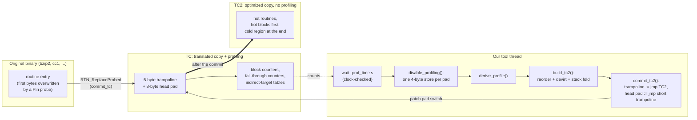
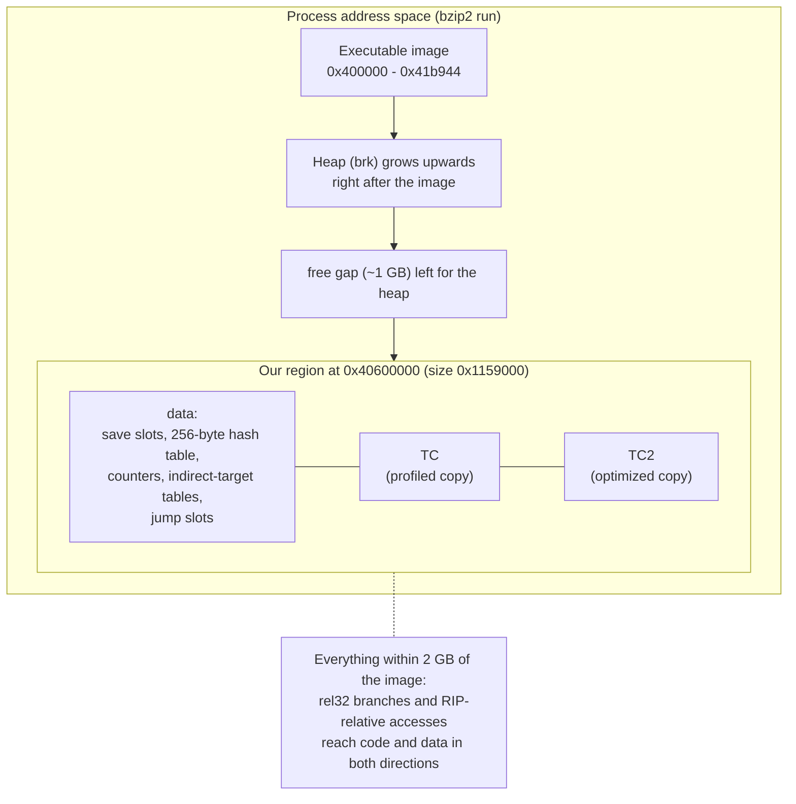
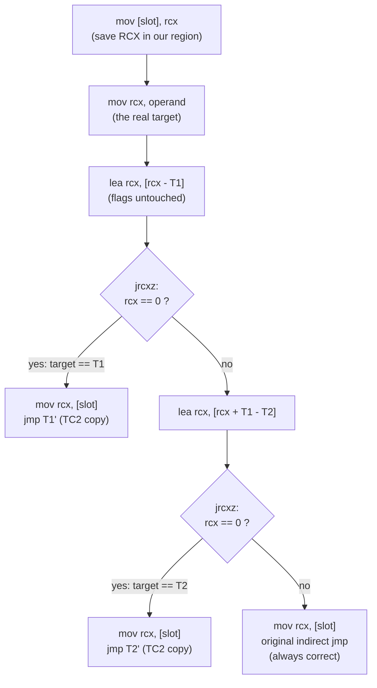
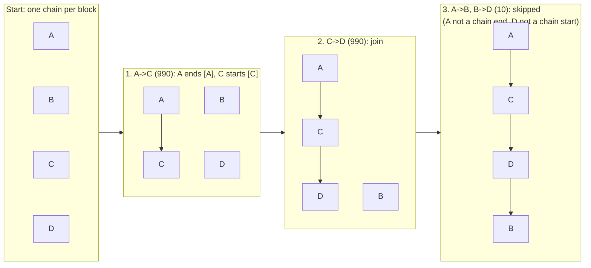
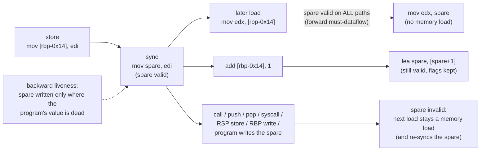

# Diagrams (Mermaid)

Paste each block into a Mermaid renderer (for example mermaid.live) and export as PNG/SVG for the slides.
Addresses and sizes in the diagrams are from our bzip2 run (`dumps/bzip2_tc_only.txt.gz`, `-verbose` line
`region at 0x40600000 size 0x1159000 image 0x400000-0x41b944`).

## a. Architecture: from the original binary to TC2

## b. Memory layout

## c. A hot indirect jump in TC2 (guard hit / miss)

## d. Pettis-Hansen chain merging (README example)

A ends with `jl C` (taken 990, fall-through to B 10); B ends with `jmp D` (10); C falls into D (990).

Final layout `A C D B`: A's `jl C` becomes `jnl B` (inverted, see BEFORE_AFTER d), C falls into D, B keeps `jmp D`.

## e. Stack fold: the dataflow idea

