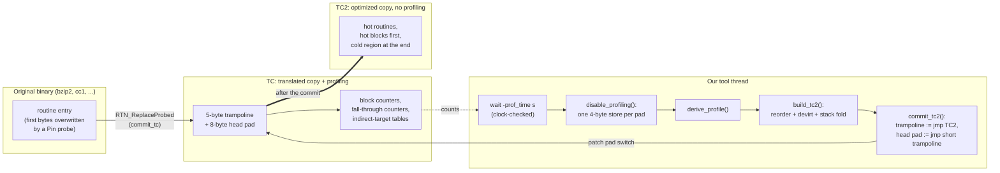
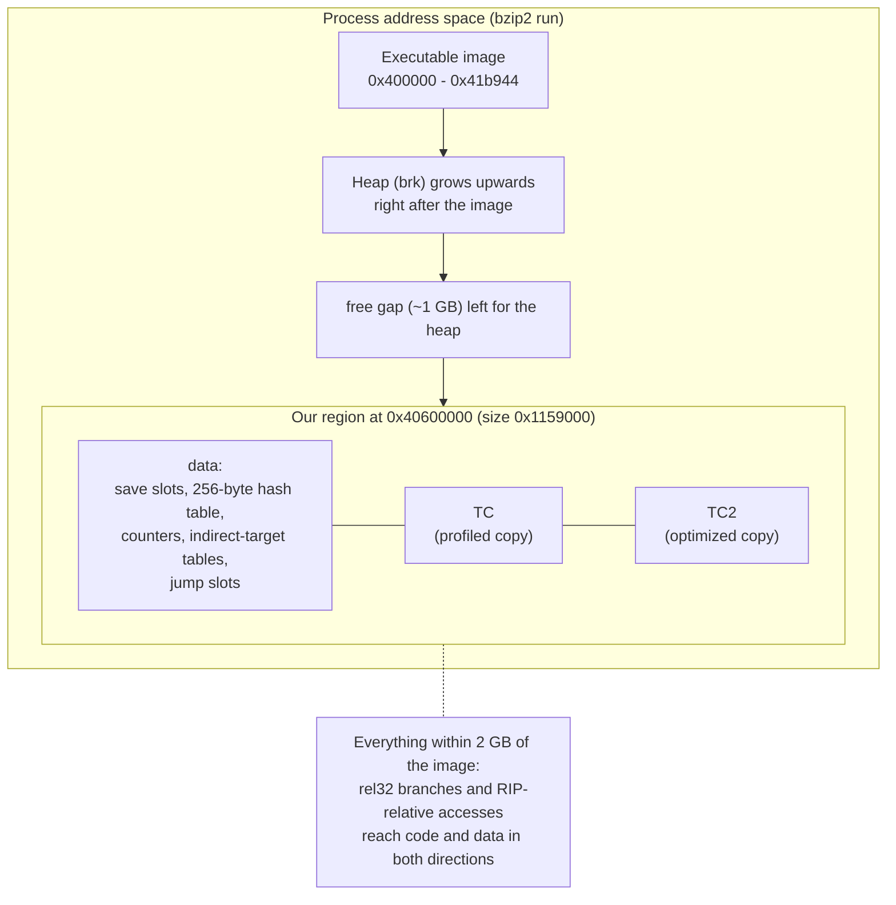
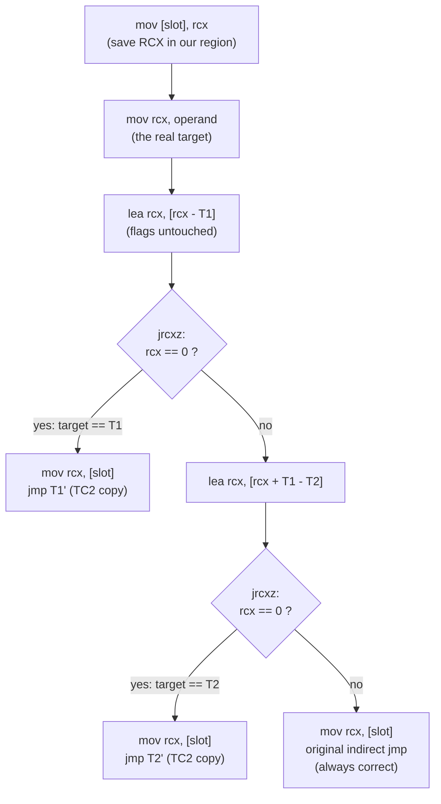
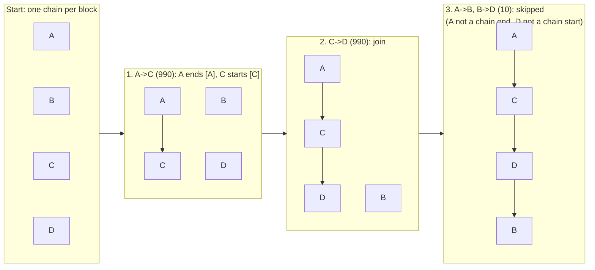
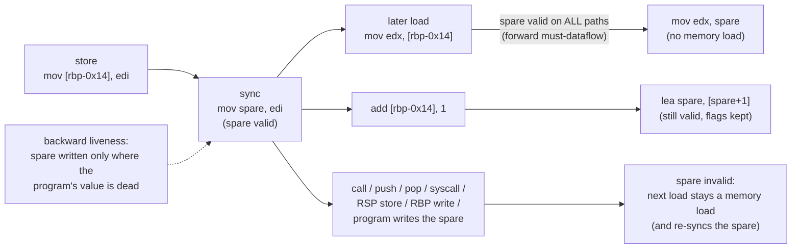

# Presentation brief

One file with all presentation texts, in this order: KEY_NUMBERS, SCRIPT, CODE_WALKTHROUGH, BEFORE_AFTER, DIAGRAMS, QA, PROJECT_LOG, STORY, HOTSPOT, FOLD_DECISIONS, DEVIRT_PRACTICE, PROFTIME, BASE_CHANGES, TRIED.
Graphs are in graphs/, the demo in demo/, the raw dumps in dumps/ (not in the zip).


<!-- ==================== KEY_NUMBERS.md ==================== -->

# Key numbers (every number we say out loud, with its source)

All sources are in our repository: `docs/VERIFICATION.md` and the raw run logs in `docs/verify_raw/`
(measured at commit 58df1e1, tool source unchanged since). "VER" = docs/VERIFICATION.md, "raw/" = docs/verify_raw/.

## The headline (bzip2, 10 paired rounds: native run, then tool run)
| what | value | source |
|---|---|---|
| median improvement vs native CPU (user+sys), tool end-to-end clock | **15.23%** | VER (STEP 4 table), raw/step4_summary.tsv |
| mean / minimum / maximum improvement | 14.22% / 5.02% / 19.88% | VER, raw/step4_summary.tsv |
| rounds above 5% | **10 of 10** | VER, raw/step4_summary.tsv |
| outputs byte-identical | 10 of 10 | VER, raw/step4_summary.tsv |
| median native CPU time | 4.75 s | raw/step4_summary.tsv |
| median tool end-to-end time | 4.05 s (4.0535) | raw/step4_summary.tsv |
| profiling window (all rounds) | 2.001-2.009 s | VER, raw/step4_summary.tsv |
| median TC2 build / commit | 0.005 s / 0.000 s | raw/step4_summary.tsv |
| median TC2 execution | 2.045 s | raw/step4_summary.tsv |
| bench.sh, 5 more rounds: median | 13.81% (11.46%-16.45%) | VER (STEP 6) |

## One run, second by second (round 1)
| TC build (before the program starts) | profiling window | TC2 build | TC2 commit | TC2 execution | end-to-end | printed "Translated code run" | source |
|---|---|---|---|---|---|---|---|
| 0.261 s | 2.001 s | 0.008 s | 0.000 s | 2.046 s | 4.055 s | 4.046 s | raw/s4_r1.txt |
Round 1 arithmetic: native CPU 4.84 + 0.03 = 4.87 s; (4.87 - 4.055) / 4.87 = 16.74% (VER).

## The same bzip2 runs measured three ways (5 paired rounds)
| clock | median improvement | rounds > 5% | source |
|---|---|---|---|
| tool's own end-to-end clock | 14.93% | 5/5 | VER (STEP 5), raw/step5_summary.tsv |
| whole pin command, user+sys CPU | 9.55% | 5/5 | same |
| whole pin command, wall clock | **6.37%** | **3/5** (3.21% and 4.47% in the other two) | same |
| what the outside clock adds (Pin start-up, building TC, exit) | 0.37-0.40 s per run | | same |

## Ablation on bzip2 (4 paired rounds each, median)
| config | median improvement | source |
|---|---|---|
| all optimizations on | +15.86% | VER (STEP 8), raw/step8_summary.tsv |
| without stack fold | -9.03% | same |
| without address fold | +2.73% | same |
| without cheap/sparse profiling | +7.61% | same |
| without de-virtualization (no hot indirect site in bzip2: identical TC2) | +14.33% | same; raw/s8_evidence_*.txt |
| without reordering | +13.22% | same |
| everything off | -14.49% | same |

## What the optimizations did on bzip2 (one -verbose run)
| item | value | source |
|---|---|---|
| translated | 118/118 routines, 23786 instructions, 2895 blocks, 28 indirect sites, TC 165634 bytes | raw/s8_evidence_default.txt |
| TC2 | 46 routines, 48003 bytes | same |
| stack fold | 77 routines, 1914 loads replaced, 775 register syncs, 130 address folds | same |
| mainGtU | 207 loads, 7 slots kept in registers | same |
| reordering | 118 jumps inverted, 97 jumps added, 44 jumps removed, 758 cold blocks | same |
| our memory region | at 0x40600000, size 0x1159000; image 0x400000-0x41b944 | same |
| hot/cold threshold | 1.613e9 block executions in the window -> threshold 1613 | raw/x_dump_prof_bzip2.txt |

## cc1 and the gcc family
| item | value | source |
|---|---|---|
| cc1 de-virtualized sites (default) | 81 indirect calls + 171 indirect jumps | raw/s8_evidence_cc1_devirt.txt |
| cc1 TC2 | 2164 routines | same |
| stress test (-devirt_min_count 1 -devirt_min_pct 50) | cc1 144 calls + 228 jumps; sgcc_peak 552 calls + 490 jumps; output identical | raw/s3_stress_cc1.txt, raw/s3_stress_sgcc_peak.txt |
| cc1, mean of 2 rounds: default / no devirt / no reorder / both off | -13.57% / -22.81% / -20.23% / -23.82% | VER, raw/cc1_ablation_summary.tsv |
| cc1 per round (correctness pairs) | -45.89%, -15.19% | VER, raw/step3_summary.tsv |
| sgcc_base | -38.11%, -30.40% | same |
| sgcc_peak | -64.48%, -45.72% (setarch -R: -49.89%, -36.15%) | same |
| cpugcc_r_base | -23.67%, -19.38% | same |

## The base tool (bprofile-with-gearing.cpp built unchanged)
| item | value | source |
|---|---|---|
| bzip2 | correct, printed time 9.22 s vs native 5.86 s (-57.30%) | VER, raw/x_base_bzip2.txt |
| cc1 | **wrong output**, first difference at byte 6669460 | VER, raw/x_base_cc1.txt |

## Correctness
| item | value | source |
|---|---|---|
| benchmarks byte-identical (fresh native run, separate output file) | 5 of 5, 2 rounds each | VER (STEP 3), raw/step3_summary.tsv |
| sgcc_peak under setarch -R | identical, 2 rounds | same |
| bzip2 extra modes (-1, -9, -d, -t, stdin, -dc, empty, 1 KB, 3 MB random) | 9 of 9 identical | raw/modes_*.txt |
| round trips (both directions) | identical | raw/step3_roundtrip.txt |
| a flipped byte is detected by cmp | 5 of 5 benchmarks | raw/step3_O5_*.txt |

## Thresholds (defaults in project.cpp)
| rule | value | source |
|---|---|---|
| cold block | count < 1 ppm of all block executions (and every count 0) | project.cpp:1989 (`-cold_ppm`, default 1) |
| devirt site | >= 100 executions; <= 3 targets, each >= 10%; together >= 80% | project.cpp:1749-1768 (knob defaults at the top of project.cpp) |


<!-- ==================== SCRIPT.md ==================== -->

# Talk script: "Profile-guided binary optimization with Pin: beating native bzip2"

Speakers: **Aubai Rabea** and **Yazan Rabea**.
Target: about 22 minutes (22:00 planned) at about 130 spoken words per minute.
Visual references: `graphs/NN_*.png`, `DIAGRAMS.md` (a-e), `CODE_WALKTHROUGH.md` (sections 1-13),
`BEFORE_AFTER.md` (a-f). Every number is listed in `KEY_NUMBERS.md` with its source file.
Slides marked **[8-MIN]** are also used in the 8-minute video cut at the end of this file.

| section | slides | time |
|---|---|---|
| 1. Introduction | 1-3 | 1:50 |
| 2. Background | 4-8 | 2:15 |
| 3. Architecture | 9-10 | 1:45 |
| 4. Code walk-through | 11-23 | 9:25 |
| 5. Bugs we found and fixed | 24-26 | 1:55 |
| 6. Results | 27-31 | 2:50 |
| 7. Live demo | 32 | 1:30 |
| 8. Conclusions | 33-34 | 0:30 |
| **total** | **34 slides** | **22:00** |

---

## Section 1: Introduction (1:50)

### Slide 1: Title [8-MIN] (0:25)
- Profile-guided binary optimization with Pin
- From a run-time profile to faster-than-native machine code
- Aubai Rabea, Yazan Rabea
- Visual: title, course name, headline "bzip2: 15.23% faster than native (median of 10 rounds)"

**Aubai:** Hi, I'm Aubai Rabea, and this is Yazan Rabea. Our project is a Pin tool that runs a program, profiles it
while it runs, rewrites its hot code, and switches the running program over to the rewritten code. On bzip2 the
result is faster than the original binary, even though we pay for the profiling.

### Slide 2: Agenda (0:15)
- The problem and the requirement
- Background: probe mode, TC and TC2, how we measure time
- Architecture and a code walk-through
- Bugs we found, results, a live demo, conclusions
- Visual: agenda list

**Yazan:** First the problem, then the background, the architecture and a code walk-through with real examples from
our dumps, then the bugs we found, our results, a live demo and our conclusions.

### Slide 3: The problem [8-MIN] (1:10)
- Run the program in TC with profiling for -prof_time seconds (default 2)
- A thread builds an optimized TC2; the program continues there
- Required: de-virtualization + at least one more optimization
- Goal: the printed time, including profiling, more than 5% better than native
- Output must stay byte-identical
- Visual: requirement box + the five benchmarks (bzip2, cc1, sgcc_base, sgcc_peak, cpugcc_r_base)

**Aubai:** The assignment: write a probe-mode Pin tool, based on our exercise 4, that runs a program in a first
translation cache, TC, with profiling code, for a fixed time, two seconds by default. Then a separate thread uses
the profile to build a second, optimized cache, TC2, and the program continues there. De-virtualization is required,
plus at least one more optimization. And the hard part: the printed time, including the profiling, must be more than
five percent better than native on at least one of five programs: bzip2, cc1, and three builds of gcc.

**Yazan:** Native never pays for profiling, and translated code has overheads of its own. So "faster than native"
does not come for free. And there is one rule we never broke: whatever we do, the output must stay byte for byte the
same as the native run, on every program and in every run.

---

## Section 2: Background (2:15)

### Slide 4: Pin probe mode [8-MIN] (0:25)
- Pin overwrites the first bytes of a routine with a jump (a probe)
- No JIT: the program runs natively
- We use probes to send every routine to our own copy
- Visual: DIAGRAMS a (left half: original routine -> probe -> TC)

**Yazan:** In probe mode Pin does not interpret the program and does not JIT-compile it. It only lets us overwrite
the first bytes of a routine with a jump, a probe. We use that to redirect every routine of the executable into code
we wrote ourselves. Everything else is our job: our copy must behave exactly like the original.

### Slide 5: TC to TC2 gearing [8-MIN] (0:25)
- TC: translated code + counters, runs for prof_time seconds
- Our thread: stop profiling, read counters, build TC2
- Switch each routine head from TC to TC2 while the program runs
- Visual: DIAGRAMS a (full)

**Aubai:** First the program runs in TC, a translated copy with counters. After two seconds our thread switches the
profiling off, reads the counters, builds TC2 with all the optimizations, and then switches every routine head from
its TC copy to its TC2 copy, while the program keeps running. From then on, every new call enters optimized code.

### Slide 6: Timing model (0:45)
- Clock starts when the program's first instruction runs in TC
- End-to-end = window + TC2 build + commit + TC2 execution
- Printed line "Translated code run" = prof_time + TC2 execution
- Native = user + system CPU time
- Visual: graphs/08_run_timeline.png

**Yazan:** This is one real bzip2 run. Our clock starts when the program executes its first instruction, and stops
when it calls exit. Building TC takes a quarter of a second, but before the program starts, so native does not have
it either. Then two seconds of profiling, eight milliseconds to build TC2, and two seconds in TC2: four point zero
five five seconds end to end. The line the assignment asks us to print is prof time plus TC2 execution. It is always
a little smaller than our end-to-end time, so we report the stricter end-to-end number.

### Slide 7: Why beating native is hard (0:25)
- Almost half of bzip2's run happens inside the profiling window
- Classic optimizations give a few percent on cache-friendly code
- Overheads: counters, jumps over switched-off stubs
- Visual: graphs/01_bzip2_native_vs_tool.png (native bar only)

**Aubai:** Native bzip2 takes about four point seven five seconds of CPU, and two of those seconds are our profiling
window. Code reordering and de-virtualization alone give a few percent at most on a small, cache-friendly program.
That cannot pay for profiling. So we needed something that makes the code itself faster than the original binary.

### Slide 8: The opportunity: bzip2 is -O0 [8-MIN] (0:15)
- Every local lives in [rbp-X] and is reloaded for every use
- Visual: BEFORE_AFTER e (original listing only)

**Yazan:** But bzip2 is compiled without optimization. Every local variable lives on the stack and is reloaded for
every single use. Here in mainGtU: store i1, reload i1, reload block, add, load. That is our opportunity.

---

## Section 3: Architecture (1:45)

### Slide 9: Architecture overview (0:55)
- create_tc: analyze, stack-fold analysis, place region, build TC, probe
- Our thread: wait, disable profiling, derive profile, build TC2, commit
- Fini at _exit: the timing report
- Visual: DIAGRAMS a; CODE_WALKTHROUGH 1

**Aubai:** Here is the whole flow in our code. When Pin loads the main executable, it calls create_tc, before the
program runs a single instruction. create_tc decodes every routine, computes the stack-fold rewrite once for both
caches, places our memory region, builds TC and probes every routine. Only then does the program start, and only
then does our clock start. Our thread waits for the window with short sleeps that check the clock, because on our
virtual machine a single long sleep sometimes overshot. Then it switches the profiling off, derives the profile,
builds TC2 and commits it. When the program calls exit, our replacement of underscore exit calls Fini, which prints
the timing report.

### Slide 10: Memory layout (0:50)
- One region: data | TC | TC2
- About 1 GB above the image: room for the heap
- Within 2 GB of the code: rel32 and RIP-relative accesses reach
- Visual: DIAGRAMS b; CODE_WALKTHROUGH 3

**Yazan:** All our code and data live in one memory region: first the data, meaning counters, target tables and save
slots, then TC, then TC2. The base tool mapped its caches right after the program, which is exactly where the heap
grows. We place the region about one gigabyte above the end of the whole image, but still within two gigabytes, so
every relative branch and every RIP-relative access still reaches both the program and our region. For bzip2 it sits
at address 0x40600000. And if placement ever fails, we print an ERROR line, instead of silently running the original
code and making it look as if our optimizations just did nothing.

---

## Section 4: Code walk-through (9:25)

### Slide 11: Profiling: what we count (0:30)
- Every basic block (as in exercise 4)
- Fall-through after every conditional jump
- Targets of every indirect jump AND indirect call
- Visual: CODE_WALKTHROUGH 2 (block formation lines)

**Aubai:** The profiling is based on our exercise 4. A basic block starts at a routine entry, at every branch
target, and after every jump. We count every block, and the fall-through path of every conditional jump, so the
taken count is executions minus fall-through. And we record the targets of every indirect jump and every indirect
call, which is exactly what de-virtualization needs.

### Slide 12: Counters that never change the flags [8-MIN] (0:55)
- Flags dead? one `add qword [rip+ctr], 1`
- Otherwise a dead register: mov / lea / mov
- Otherwise save RAX in our region, never push (red zone)
- Visual: CODE_WALKTHROUGH 4; BEFORE_AFTER a (cheap form + save/restore form)

**Yazan:** A counter is inserted between two instructions of the program, so it must not change anything the program
still needs, including the flags. If our analysis proves the flags are dead, meaning the next instructions overwrite
all six status flags before anyone reads them, the counter is a single add, placed right before the block's compare.
Otherwise we borrow a register that is dead, with mov, lea, mov, which never touch the flags. As a last resort we
save RAX in our region. We never push, because minus O zero leaf functions keep local variables below the stack
pointer, where a push would overwrite them. On the slide you see both forms in the real TC of bzip2.

### Slide 13: Sparse profiling (0:35)
- One predecessor -> no counter of its own
- A fall-through block's counter = the jump's fall-through counter
- Derived after the window
- Visual: CODE_WALKTHROUGH 6

**Aubai:** A block with exactly one predecessor does not need its own counter: we derive its count after the window
from the predecessor. And when that block is the fall-through of a conditional jump, its counter doubles as that
jump's fall-through counter. This removed most of the fall-through stubs from TC. We only do this in routines
without indirect jumps, and never for a routine entry, because there we cannot know all the predecessors.

### Slide 14: Indirect targets without touching the flags (0:30)
- 16 slots per site, slot = (target >> 4) & 15
- Computed with MOVZX and a 256-byte table
- The base tool used AND RAX,3: wrong flags, one slot
- Visual: CODE_WALKTHROUGH 5; BEFORE_AFTER a (indirect profile)

**Yazan:** For indirect branches we keep sixteen slots per site. The slot index uses bits four to seven of the
target, because many targets are sixteen-byte aligned and their low bits are always zero. We compute it with MOVZX
and a small lookup table, so no instruction changes the flags. The base tool used AND RAX, 3 here, which changes the
flags and puts all aligned targets into the same slot.

### Slide 15: Switching live code safely [8-MIN] (0:55)
- 8-byte pad = two NOPs, split so pad+k is 4-byte aligned
- One aligned 4-byte store -> "jmp short"
- Trampoline written first, then the head pad flips
- Visual: CODE_WALKTHROUGH 7; BEFORE_AFTER f (live memory before/after)

**Aubai:** The program keeps running while we change its code, so no CPU may ever see half an instruction. Every
stub and every routine head starts with an eight-byte pad made of two NOPs, split so that the second one starts on a
four-byte boundary. Switching the pad is one aligned four-byte store of a short jump, and an aligned store can never
be seen half-written. For the switch to TC2, we first write a full jump into a small trampoline in front of the
head, which nothing executes yet, and then flip the pad. These bytes were read from the running bzip2 process before
and after the switch: the trampoline now jumps to 0x40f13000, exactly mainGtU's first instruction in TC2.

### Slide 16: A fresh TC2 (0:35)
- Built from the original instructions, not from TC
- Only routines that ran; hot ones first; one cold region
- Every branch decoded again and checked
- Visual: CODE_WALKTHROUGH 8 and 12

**Yazan:** TC2 is built from the original instructions, not by editing TC, so every entry knows its true original
address, and every RIP-relative operand is recomputed from it. Only routines that ran during the window get a copy.
After layout we decode every branch again from memory and check that it reaches its intended target, a cheap guard
against our own mistakes. Hot routines are placed first, ordered by how hot they were in the profile.

### Slide 17: De-virtualization: the rule (0:30)
- Site ran at least 100 times
- At most 3 targets, each at least 10%
- Together at least 80% of the executions
- Visual: CODE_WALKTHROUGH 9 (devirt_targets lines)

**Aubai:** De-virtualization replaces hot indirect branches with direct ones. A site qualifies if it ran at least a
hundred times during the window, and its top targets, at most three, each with at least ten percent, together cover
at least eighty percent of its executions. Otherwise the compares would cost more than they save. With these
defaults, cc1 gets eighty-one guarded calls and one hundred seventy-one guarded jumps.

### Slide 18: The call guard [8-MIN] (0:40)
- cmp target, T ; jnz next ; call T' ; jmp done
- Original indirect call stays as the fallback
- CMP allowed: flags are dead across a call
- Visual: BEFORE_AFTER b (htab_traverse in cc1)

**Yazan:** Here is a real call site from cc1: htab_traverse calls its callback through register r13. In TC2 we
compare r13 with the two hot callbacks from the profile and call their TC2 copies directly. If neither matches, the
original indirect call runs, so the result is always the same. Using CMP is fine here, because the calling
convention does not keep flags across a call anyway. Because the original call is always kept as the last step, even
a completely wrong profile can only cost a few compares, never a wrong result.

### Slide 19: The jump guard without flags [8-MIN] (0:50)
- Flags can be live across a switch jump (cc1)
- lea rcx,[rcx-T] + jrcxz: an equality test without flags
- RCX saved in our region on every path
- Visual: BEFORE_AFTER c; DIAGRAMS c

**Aubai:** Jumps are harder. In cc1 the flags can be live across a switch jump, so the guard may not change them.
Our trick: save RCX in our region, load the real target into RCX, subtract the expected target with LEA, which
leaves the flags alone, and use JRCXZ, which jumps if RCX is zero, again without reading or writing flags. A hit
restores RCX and jumps straight to the TC2 copy. A miss restores RCX and takes the original jump. This is the real
guard in cc1's ggc_mark_rtx_children_1, and in a stress test, where we guarded hundreds of sites, every output
stayed identical.

### Slide 20: Code reordering: Pettis-Hansen (0:30)
- Edges weighted by the profile, heaviest first
- Join chains so the hot successor falls through
- Entry chain first; hot routines ordered by hotness
- Visual: DIAGRAMS d; CODE_WALKTHROUGH 10

**Yazan:** Our second required optimization is code reordering, following the recommended paper by Newell and
Pupyrev. We weight every edge with the profile and merge chains, heaviest edge first, so that the hottest successor
of every block falls through. In this example, A to C and C to D join into one chain, B ends up after them, and the
hot path A, C, D has no taken jump at all.

### Slide 21: Inversion, cold region, the paper (0:50)
- Taken target follows -> invert the jcc (link1.txt table)
- Broken fall-through -> add jmp; jmp to the next block -> drop it
- Cold blocks (< 1 ppm of all executions) to one region
- ExtTSP not implemented: about 0.5-1% in the paper
- Visual: BEFORE_AFTER d (mainGtU jz -> jnz); graphs/10_reorder_stats.png

**Aubai:** When the taken successor now comes right after the branch, we invert the condition, using the table from
the course's link1 example. Here, mainGtU's jz became jnz in TC2. Where a fall-through was broken we add a jump, and
a jump to the very next block is removed. On bzip2 we inverted one hundred eighteen branches and moved seven hundred
fifty-eight cold blocks into a single cold region. Cold means below one part per million of all block executions in
the window. The paper's ExtTSP refinement reports about half a percent to one percent more, which is below our
measurement noise, so we did not implement it.

### Slide 22: Stack fold [8-MIN] (1:05)
- Keep hot stack slots in spare registers
- Liveness: write a spare only where the program's value is dead
- Must-dataflow: replace a load only if valid on every path
- Stores stay; lea keeps the spare in sync
- Visual: DIAGRAMS e; CODE_WALKTHROUGH 11

**Yazan:** Now the optimization that makes bzip2 faster than native. For each minus O zero routine we keep the most
read stack slots in spare caller-saved registers. A backward liveness analysis tells us where a spare may be written
without destroying a value the program still needs. A forward dataflow analysis tells us where the spare provably
equals its slot on every path into that point. Then a reload becomes a register move, every store stays and also
updates the spare, and an add to memory is followed by a flag-free LEA on the spare. Calls, push and pop, stores
through the stack pointer, and any slot whose address is taken all invalidate the spare. When we are unsure, we do
not fold. We apply this in both TC and TC2, because almost half of bzip2's run happens inside the profiling window.

### Slide 23: Stack fold + address fold in mainGtU [8-MIN] (1:00)
- Reloads of i1, i2, c1, c2 -> register moves
- mov / add / load -> one load [r11+rdx]
- 77 routines, 1914 loads replaced, 130 address folds
- Visual: BEFORE_AFTER e; graphs/09_stackfold_routines.png

**Aubai:** This is mainGtU before and after, taken from our TC2 dump. The reload of i1 is now a register move.
Loading the pointer, adding the index and reading the byte became one instruction, a movzx from r11 plus rdx: that
is the address fold. And the compare of c1 and c2 now uses registers instead of memory. Over the whole program:
seventy-seven routines, one thousand nine hundred fourteen loads replaced and one hundred thirty address folds. All
the stores to the stack are still there, so memory is always exactly as in the original program; only reads that we
can prove are redundant are gone. The chart shows the routines with the most folded loads: mainGtU alone has two
hundred seven, kept in seven registers.

---

## Section 5: Bugs we found and fixed (1:55)

### Slide 24: The base tool breaks cc1 (0:45)
- Base tool on cc1: output differs at byte 6669460
- Cause: AND RAX,3 in the indirect-jump stub changes the flags
- Fix: all stubs and jump guards are flag-free
- Visual: graphs/06_base_vs_ours.png

**Yazan:** The first thing we did was run the base tool as it was given. On bzip2 it is correct but fifty-seven
percent slower than native. On cc1 the output is simply wrong: the first difference is at byte six million six
hundred sixty-nine thousand four hundred sixty. The cause is the AND in its indirect-jump stub, which changes the
flags while cc1 still needs them. That is why everything we insert is flag-free. We confirmed this again in our
final measurements, and in the demo you can see the same difference at the same byte.

### Slide 25: Probes overwriting bytes others jump into (0:50)
- sgcc_peak crashed; we found the routine by translating halves of the routine list
- htab_expand's .cold part is entered 2 bytes after its start
- uid_decl_map_hash: symbol size 3, its ret is the 4th byte
- Fix: decode the whole image; such routines are translated but not probed
- Visual: CODE_WALKTHROUGH 2 (lines 601-640, 669-675)

**Aubai:** Our own first version crashed on sgcc_peak. We found the culprit by translating only half of the
routines, then half of that half, and so on, until one routine was left. Pin's probe overwrites the first bytes of a
routine, but the cold part of htab_expand is entered by its parent two bytes after its start, right inside the
overwritten bytes. A second case: a symbol of size three whose return instruction is the fourth byte. The fix:
decode the whole image first, and never probe a routine that some code jumps into near its start. It is still
translated and still reached from our own code.

### Slide 26: Heap placement and safe patching (0:20)
- Base tool: caches where the heap grows; we go 1 GB higher
- Multi-byte patches could tear; we use one 4-byte store
- Failures print ERROR, never fail silently
- Visual: DIAGRAMS b

**Yazan:** Two more design fixes from reading the base tool: its caches sit where the heap grows, and it patches
live code with multi-byte writes that another CPU could see half-done. We moved the region and use single aligned
stores.

---

## Section 6: Results (2:50)

### Slide 27: bzip2 vs native [8-MIN] (0:40)
- Median native CPU 4.75 s, median tool 4.05 s end-to-end
- Median improvement 15.23%
- Visual: graphs/01_bzip2_native_vs_tool.png

**Aubai:** Now the results. We measured ten paired rounds: each round runs native bzip2 and then our tool. Native
bzip2 took a median of four point seven five seconds of CPU. Under our tool, end to end, including the two-second
profiling window, it took four point zero five seconds. That is a median improvement of fifteen point two three
percent. The improvement is computed per round, as native CPU time minus our end-to-end time, divided by native CPU
time, and then we take the median over the rounds.

### Slide 28: Every round counts [8-MIN] (0:35)
- 10 of 10 rounds above 5%
- Worst round 5.02%, best 19.88%
- All 10 outputs byte-identical
- Visual: graphs/02_bzip2_rounds.png

**Yazan:** And it is not only the median: every one of the ten rounds is above five percent. The worst round is five
point zero two percent, the best is nineteen point eight eight, and all ten outputs are byte-identical to native.
The weakest round had a longer TC2 execution than the others, and even it stays above the target. An automated
script with five more rounds gave a median of thirteen point eight one percent.

### Slide 29: Where the speed comes from [8-MIN] (0:35)
- Without stack fold: -9.03%
- Without address fold: +2.73%
- Without cheap profiling: +7.61%
- Everything off: -14.49%
- Visual: graphs/03_bzip2_ablation.png

**Aubai:** Turning optimizations off one at a time shows where the speed comes from. Without the stack fold we are
nine percent slower than native. Without the address fold we barely beat native. Cheap profiling adds about eight
points. With everything off we are fourteen and a half percent slower. Reordering and de-virtualization change
little on bzip2, which has no hot indirect branch at all. The stack fold together with the address fold is the core
of our result.

### Slide 30: Measured honestly, three ways [8-MIN] (0:35)
- Tool clock: 14.93%
- Whole pin run, CPU: 9.55%
- Whole pin run, wall clock: 6.37% (3 of 5 rounds above 5%)
- Visual: graphs/05_bzip2_three_clocks.png

**Yazan:** We also measured from outside, with /usr/bin/time around the whole pin command. That includes Pin's own
start-up and building TC, about four tenths of a second per run. Measured that way, the median gain is still six
point three seven percent in wall-clock time and nine point five five percent in CPU time. In wall-clock time two of
the five rounds were below five percent, and we want to be upfront about that.

### Slide 31: cc1 and the gcc family (0:25)
- De-virtualization and reordering help cc1 (-13.57% vs -23.82%)
- Still slower than native: already optimized code
- Correct everywhere
- Visual: graphs/04_cc1_devirt_reorder.png, graphs/07_gcc_family.png, graphs/11_correctness_matrix.png

**Aubai:** On cc1, de-virtualization and reordering do help: minus thirteen point six percent with them, minus
twenty-three point eight without. But the gcc binaries are already optimized, so there is little to fold, and they
stay slower than native. What matters to us: all five programs produce byte-identical output in every run.

---

## Section 7: Live demo (1:30)

### Slide 32: Demo [8-MIN] (1:30)
- `docs/presentation/demo/demo.sh` (native, tool, cmp, improvement)
- Visual: terminal (screen recording)

**Yazan:** Let's see it live. The script runs exactly the commands from our README. First, native bzip2 compresses
the twenty-megabyte input. It takes a bit over four seconds.

**Aubai:** Now the same command under our tool. Watch the timing lines: the TC build before the program starts, two
seconds of profiling, a TC2 built in a few milliseconds, and then the rest of the run in TC2. It finishes well
before native.

**Yazan:** Next, cmp: the two compressed files are byte-identical, same size and same md5. Finally, the script
computes the improvement from the two measured times, both against native CPU time and for the printed line. Every
single run varies a little on this machine; the numbers on our slides are the medians of ten paired rounds. If time
allows, the second part of the script runs cc1 under the base tool, whose output differs, and under our tool, whose
output is identical.

**Aubai:** While it runs, notice that the profiling window ends after almost exactly two seconds, because our thread
checks the clock in short sleeps. The script is in our repository under docs, presentation, demo, if you want to run
it yourself.

---

## Section 8: Conclusions (0:30)

### Slide 33: Conclusions and limitations [8-MIN] (0:20)
- bzip2: 15.23% faster than native, output always identical
- Required de-virtualization + reordering work, and help cc1
- Limits: single-threaded save slots; gcc binaries slower than native
- Visual: summary bullets

**Aubai:** To sum up: bzip2 runs fifteen percent faster than native including profiling, and every output is
identical. The required optimizations work and help cc1. Our limits: the save slots assume a single-threaded
program, and the gcc binaries stay slower than native.

### Slide 34: Future work and thanks (0:10)
- ExtTSP, per-thread save slots, more spare registers
- Thank you, questions
- Visual: thank-you slide

**Yazan:** With more time we would add ExtTSP and per-thread save slots. Thank you, we are happy to take questions.

---

## Backup slides (not timed)
- **B1. Q&A**: QA.md (questions with short answers).
- **B2. Correctness matrix**: graphs/11_correctness_matrix.png and KEY_NUMBERS "Correctness".
- **B3. Knob table**: README.txt section 11 (all knobs with defaults).
- **B4. gcc family per round**: graphs/07_gcc_family.png.
- **B5. One run, second by second**: graphs/08_run_timeline.png.
- **B6. All profiling stub forms**: BEFORE_AFTER a.
- **B7. Exercise 4 mapping**: README.txt section 2 table.

---

# 8-MINUTE CUT (the course video)

Covers (1) the problem, (2) the solution with a code walk-through, (3) measurement results as graphs.
13 slides built from the full-talk slides; the spoken text below is the shortened version.

| # | video slide (from full-talk slide) | visual | time |
|---|---|---|---|
| V1 | Title (1) | title slide | 0:20 |
| V2 | The problem (3) | requirement box | 0:40 |
| V3 | Probe mode + gearing (4+5) | DIAGRAMS a | 0:40 |
| V4 | The opportunity: bzip2 is -O0 (8) | BEFORE_AFTER e (original) | 0:20 |
| V5 | Counters that never change the flags (12) | CODE_WALKTHROUGH 4, BEFORE_AFTER a | 0:40 |
| V6 | Switching live code safely (15) | BEFORE_AFTER f | 0:35 |
| V7 | De-virtualization: call + jump guards (18+19) | BEFORE_AFTER b, c | 0:55 |
| V8 | Code reordering + inversion (20+21) | DIAGRAMS d, BEFORE_AFTER d | 0:40 |
| V9 | Stack fold + address fold (22+23) | DIAGRAMS e, BEFORE_AFTER e | 0:50 |
| V10 | bzip2 vs native + every round (27+28) | graphs/01, graphs/02 | 0:40 |
| V11 | Where the speed comes from + three clocks (29+30) | graphs/03, graphs/05 | 0:35 |
| V12 | Demo, shortened (32) | terminal | 0:45 |
| V13 | Conclusions (33) | summary | 0:20 |
| | **total** | | **8:00** |

### V1. Title (0:20)
**Aubai:** Hi, we are Aubai Rabea and Yazan Rabea. Our Pin tool profiles a running program, rewrites its hot code,
and switches the program over to it while it runs. On bzip2 the result is faster than the original binary, even
including the time spent profiling.

### V2. The problem (0:40)
**Aubai:** The task: a probe-mode Pin tool, based on our exercise 4, runs the program in a translation cache, TC,
with profiling for two seconds. Then a thread builds an optimized cache, TC2, and the program continues there. De-
virtualization is required, plus at least one more optimization, and the printed time, profiling included, must beat
native by more than five percent on one of five programs.

**Yazan:** Native never pays for profiling, so this is hard. And the output must stay byte for byte identical, on
every program and in every run.

### V3. Probe mode and gearing (0:40)
**Yazan:** In probe mode, Pin only lets us overwrite the start of each routine with a jump, and we send every
routine into our copy, TC, which has counters. After two seconds our thread switches the profiling off, builds TC2
from the profile, and switches every routine head from TC to TC2 while the program keeps running. Our clock runs
from the program's first instruction to its exit. From then on, every new call enters the optimized code, and TC2
itself is built in a few milliseconds.

### V4. The opportunity (0:20)
**Aubai:** Our opportunity: bzip2 is compiled without optimization. Every local variable lives on the stack and is
reloaded for every use, like i1 and the block pointer here in mainGtU. Removing those reloads, in both caches, is
how we get below native.

### V5. Cheap, flag-safe counters (0:40)
**Yazan:** Profiling code sits between the program's instructions, so it must never change anything the program
needs, including the flags. Where our analysis proves the flags are dead, a counter is a single add. Otherwise we
use a dead register with mov and lea, which leave the flags alone, and we never push, because minus O zero code
keeps locals below the stack pointer. Blocks with a single predecessor get no counter at all. Indirect jumps and
calls get small target tables, also filled without touching the flags.

### V6. Switching live code (0:35)
**Aubai:** Every stub and routine head starts with an eight-byte NOP pad. One aligned four-byte store turns it into
a short jump, so no CPU can ever see half an instruction. These bytes were read from the running process: after the
switch, mainGtU's TC head jumps straight to its TC2 copy. We first write a full jump into a small trampoline that
nothing executes yet, and only then flip the pad, so the switch is safe while the program keeps running.

### V7. De-virtualization (0:55)
**Yazan:** For a hot indirect call, like the callback in cc1's htab_traverse, TC2 compares the target with the two
hot callbacks from the profile and calls their TC2 copies directly; otherwise the original indirect call runs.

**Aubai:** Jumps are harder, because cc1 keeps flags live across switch jumps. So the jump guard saves RCX in our
region, subtracts the expected target with LEA, and uses JRCXZ, which tests for zero without touching the flags. A
miss always falls back to the original jump, so the output can never change. A site must run at least a hundred
times, and up to three targets must cover eighty percent of it. In cc1 that gives eighty-one guarded calls and one
hundred seventy-one guarded jumps.

### V8. Code reordering (0:40)
**Yazan:** For reordering we follow the recommended paper by Newell and Pupyrev: weight every edge with the profile,
merge chains along the heaviest edges so the hot successor falls through, invert branches with the table from the
course example, and move cold blocks into one region. In mainGtU, jz became jnz, so the hot path falls through. On
bzip2 we inverted one hundred eighteen branches and moved seven hundred fifty-eight cold blocks, where cold means
below one part per million of all block executions.

### V9. Stack fold (0:50)
**Aubai:** The optimization that beats native: we keep the most-read stack slots in spare registers. Liveness tells
us where a spare may be written, and a must-dataflow tells us where it provably equals its slot on every path.
Stores stay, reloads become register moves, and mov, add, load becomes one load from r11 plus rdx. Over bzip2 that
is one thousand nine hundred fourteen loads replaced, in TC and in TC2. Every store to the stack is kept, so memory
is always exact; only reads we can prove redundant disappear. Calls, push, pop and any slot whose address is taken
invalidate the spare registers, and when we are unsure, we do not fold.

### V10. Results (0:40)
**Yazan:** Over ten paired rounds, native bzip2 took a median of four point seven five seconds of CPU and our tool
four point zero five seconds end to end, profiling included. That is a median improvement of fifteen point two three
percent. All ten rounds are above five percent, the worst is five point zero two, and every output is identical. The
improvement is computed per round against native user plus system CPU time, and the profiling window is fully
included in our time.

### V11. Why, and measured honestly (0:35)
**Aubai:** Without the stack fold we would be nine percent slower than native, so that is where the gain comes from.
Measured from outside, including Pin's own start-up, the median gain is still six point three seven percent in wall-
clock time, with two of five rounds below five percent, and nine point five five percent in CPU time. On cc1, de-
virtualization and reordering help, but the already optimized gcc binaries stay slower than native. Cheap profiling
adds about eight more points.

### V12. Demo (0:45)
**Yazan:** Live: native bzip2, then the same command under our tool. Two seconds of profiling, TC2 built in a few
milliseconds, and the run ends before native. cmp says the files are identical, and the script prints the
improvement computed from the two times. The script runs exactly the commands from our README. The TC build happens
before the program starts, the profiling window ends after two seconds, and the rest of the run is in TC2. Every run
varies a little; our slides use the median of ten paired rounds.

### V13. Conclusions (0:20)
**Aubai:** bzip2 runs fifteen percent faster than native including profiling, with identical output on all five
programs. The gcc binaries stay slower, because they are already optimized. Thank you for watching. All our raw
measurements and scripts are in our project repository.

<!-- ==================== CODE_WALKTHROUGH.md ==================== -->

# Code walkthrough

All excerpts are copied from `project.cpp` (the submitted source) with their real line numbers;
`...` marks lines we left out. Function line ranges are computed from the source file.

## 1. Overall flow: main, create_tc, create_tc2_thread_func

Functions: `main()` project.cpp:2186-2195, `create_tc()` project.cpp:2141-2175, `create_tc2_thread_func()` project.cpp:2066-2097

```cpp
 2188      if (PIN_Init(argc, argv)) return Usage();
 2189      PIN_InitSymbols();
 2190      IMG_AddInstrumentFunction(create_tc, 0);
 2191      THREADID tid = PIN_SpawnInternalThread(create_tc2_thread_func, NULL, 0, NULL);
 2192      if (tid == INVALID_THREADID) TOOL_ERROR("failed to spawn the TC2 thread");
 2193      PIN_StartProgramProbed();
 2160      if (analyze_image(img) < 0) { TOOL_ERROR("image analysis failed"); tc_state = -1; return; }
 2161      compute_stack_folds();
 2162      if (allocate_region(text_bytes) < 0) { tc_state = -1; return; }
 2163      if (build_tc() < 0) { TOOL_ERROR("TC build failed; running the original code"); tc_state = -1; return; }
   ...
 2172      commit_tc();
 2173      now(&t_app_start);
 2174      tc_state = 1;
 2071      double want = (double)KnobNumSecsDuringProfile.Value();
 2072      for (;;) {
 2073          struct timespec t;
 2074          now(&t);
 2075          double left = want - tdiff(t_app_start, t);
 2076          if (left <= 0) break;
 2077          sleep_ms(left > 0.02 ? 10 : 1);
 2078      }
   ...
 2080      if (!KnobNoProfile) disable_profiling();
 2081      now(&t_prof_end);
 2082      prof_ended = true;
 2083      double win = tdiff(t_app_start, t_prof_end);
 2084      if (win > want + 0.25) TOOL_WARN("profiling window overshoot: " << win << " s for prof_time " << want);
 2085      derive_profile();
   ...
 2087      if (build_tc2() < 0) { TOOL_ERROR("TC2 build failed; execution stays in TC"); return; }
   ...
 2092          int n = commit_tc2();
```

main() registers create_tc() as the image-load callback, starts our tool thread and hands control to Pin in probe mode. Pin calls create_tc() for every image before the program runs a single instruction; for the main executable it analyses the code, computes the stack-fold rewrite, places the memory region, builds TC and redirects every routine to its TC copy - and only then starts our end-to-end clock (line 2173). The tool thread waits for the profiling window with short, clock-checked sleeps, switches profiling off, derives the profile, builds TC2 and commits it. Without this split the program could start before TC exists, or the window could overshoot badly (we saw sleep() overshoot on our VM).

## 2. Decoding and block formation: analyze_ins, analyze_image

Functions: `analyze_ins()` project.cpp:484-546, `analyze_image()` project.cpp:582-802

```cpp
  495      if (xed_decoded_inst_get_branch_displacement_width(x) > 0) {
  496          o.flags |= IF_HAS_TARG;
  497          o.targ = o.addr + o.size + xed_decoded_inst_get_branch_displacement(x);
   ...
  505      if (cat == XED_CATEGORY_CALL) o.flags |= (o.flags & IF_HAS_TARG) ? IF_CALL : (IF_CALL | IF_IND_CALL);
  506      else if (cat == XED_CATEGORY_RET) o.flags |= IF_RET | IF_NO_FT;
  507      else if (cat == XED_CATEGORY_COND_BR) o.flags |= IF_JCC;
  508      else if (cat == XED_CATEGORY_UNCOND_BR) o.flags |= (o.flags & IF_HAS_TARG) ? (IF_JMP | IF_NO_FT) : (IF_IND_JMP | IF_NO_FT);
   ...
  516          if (rd & STATUS_FLAGS) o.flags |= IF_FLAGS_READ;
  517          else if (xed_simple_flag_get_must_write(fl) && (wr & STATUS_FLAGS) == STATUS_FLAGS) o.flags |= IF_FLAGS_KILL;
   ...
  601      // Every direct branch target in the whole image's code (translated or not), decoded linearly.
  602      // Pin's probe overwrites the first bytes of a routine; its safety check only looks inside the routine,
  603      // but e.g. a function's ".cold" part is entered from its parent a few bytes after its start.
   ...
  612              if (xed_decoded_inst_get_branch_displacement_width(&x) > 0)
  613                  image_targets.insert(a + len + xed_decoded_inst_get_branch_displacement(&x));
   ...
  639              auto it = image_targets.upper_bound(c.a);
  640              if (it != image_targets.end() && *it < c.a + 16) r.no_probe = true;
   ...
  657                  if ((o.flags & IF_HAS_TARG) && !(o.flags & (IF_JCC | IF_JMP | IF_CALL))) { r.translated = false; break; }
  658                  if (ic == XED_ICLASS_JRCXZ || ic == XED_ICLASS_LOOP || ic == XED_ICLASS_LOOPE || ic == XED_ICLASS_LOOPNE ||
  659                      ic == XED_ICLASS_XBEGIN) { r.translated = false; break; }
   ...
  672              else if (r.n_ins && !(ins_v.back().flags & IF_NO_FT)) {
  673                  size_t ci = &c - &cands[0];
  674                  if (ci + 1 >= cands.size() || cands[ci + 1].a != c.e) r.no_probe = true;
   ...
  733              bool leader = (i == r.first_ins) || all_targets.count(o.addr) ||
  734                            (ins_v[i - 1].flags & (IF_JCC | IF_JMP | IF_RET | IF_IND_JMP));
```

analyze_ins() turns one XED-decoded instruction into what the rest of the tool needs: branch target, RIP-relative address, the kind of control flow, whether it reads the status flags or overwrites all six of them, and which registers it reads or fully kills. analyze_image() first decodes the whole image to collect every branch target, because Pin's probe overwrites the first bytes of a routine and other code may jump right into them (lines 601-641). Routines with JRCXZ/LOOP/XBEGIN or a branch into the middle of an instruction stay untranslated, and a routine that runs off its end is translated but not probed (lines 669-675). Blocks start at the routine entry, at every direct branch target and after every jump, so profiling and reordering see the same block structure.

## 3. Heap-safe placement of our memory: allocate_region

Functions: `allocate_region()` project.cpp:817-857

```cpp
  820      tc_cap = text_bytes * 6 + (8 << 20);
  821      tc2_cap = text_bytes * 3 + (8 << 20);
  822      d_sites = (D_CTR + n_counters * 8 + 63) & ~63u;
  823      d_jslots = d_sites + (unsigned)site_v.size() * SITE_SLOTS * 16;
  824      n_jslots_max = 65536;
  825      data_size = (d_jslots + n_jslots_max * 8 + page - 1) & ~(page - 1);
  826      region_size = data_size + ((tc_cap + page - 1) & ~(page - 1)) + ((tc2_cap + page - 1) & ~(page - 1));
   ...
  828      const ADDRINT two_gb = 0x7FF00000ULL;       // keep a margin under 2^31
  829      ADDRINT span = img_high - img_low;
  830      if (span + region_size >= two_gb) { TOOL_ERROR("image + region larger than 2GB"); return -1; }
  831      // Everything in [img_low, region_end) must be reachable with rel32 from everywhere in it.
  832      ADDRINT hi_ok = img_low + two_gb;
  833      ADDRINT gap = 1ULL << 30;                   // ~1 GB above the image: leaves room for brk/heap
  834      if (img_high + gap + region_size > hi_ok) gap = hi_ok - img_high - region_size;
  835      for (int tries = 0; tries < 8 && !region; tries++) {
  836          ADDRINT hint = (img_high + gap + (2 << 20) - 1) & ~((ADDRINT)(2 << 20) - 1);
  837          if (hint + region_size <= hi_ok && try_map(hint, region_size, img_high, hi_ok)) break;
  838          gap /= 2;
  839      }
  840      if (!region) {
  841          // Fallback: the base tool's search (first free address above the code).
  842          TOOL_WARN("region placement ~1GB above the image failed; using the first free address above the code");
  843          for (ADDRINT a = (img_high + page - 1) & ~(page - 1); a + region_size <= hi_ok; a += 16 * page)
  844              if (try_map(a, region_size, img_high, hi_ok)) break;
  845      }
  846      if (!region) { TOOL_ERROR("failed to allocate the TC region within 2GB of the code"); return -1; }
   ...
  851      uint8_t *nib = (uint8_t *)dptr(D_NIB);
  852      for (unsigned b = 0; b < 256; b++) nib[b] = (uint8_t)(((b >> 4) & 15) * 16);
```

All our code and data live in one region: data (counters, target tables, save slots) | TC | TC2. Every rel32 branch and RIP-relative access must reach both the program and the region, so everything has to fit within 2 GB (line 832). The base tool mapped its caches at the first free address above the code - exactly where the heap grows. We aim about 1 GB above the end of the whole image (line 833) and shrink that gap only if needed, with the old search as a logged fallback and an ERROR line if nothing works. The 256-byte table at line 852 is used by the flag-free indirect-target hash.

## 4. Cheap, flag-safe block counters: emit_block_counter, flags_dead_from, find_dead_reg

Functions: `emit_block_counter()` project.cpp:1433-1463, `flags_dead_from()` project.cpp:549-559, `find_dead_reg()` project.cpp:562-575

```cpp
 1436      add_pad(E, skip, orig);
   ...
 1439      if (!KnobNoCheapProf && flags_dead_from(at, end)) {      // flags dead: one add [rip+ctr],1
 1440          xed_inst2(&ei, dstate, XED_ICLASS_ADD, 64, rip_mem(64), xed_simm0(1, 8));
 1441          if (!add_syn(E, &ei, orig, true, caddr)) return false;
   ...
 1445      int r = find_dead_reg(at, end, avoid);
 1446      xed_reg_enum_t R = r >= 0 ? gpr64[r] : XED_REG_RAX;
 1447      if (r < 0) {
 1448          xed_inst2(&ei, dstate, XED_ICLASS_MOV, 64, rip_mem(64), xed_reg(XED_REG_RAX));
 1449          if (!add_syn(E, &ei, orig, true, dptr(D_SV_RAX))) return false;
 1450      }
 1451      xed_inst2(&ei, dstate, XED_ICLASS_MOV, 64, xed_reg(R), rip_mem(64));
 1452      if (!add_syn(E, &ei, orig, true, caddr)) return false;
 1453      xed_inst2(&ei, dstate, XED_ICLASS_LEA, 64, xed_reg(R), xed_mem_bd(R, xed_disp(1, 8), 64));
 1454      if (!add_syn(E, &ei, orig)) return false;
 1455      xed_inst2(&ei, dstate, XED_ICLASS_MOV, 64, rip_mem(64), xed_reg(R));
 1456      if (!add_syn(E, &ei, orig, true, caddr)) return false;
  551      for (int k = i; k < end && k < i + 24; k++) {
  552          const oins_t &o = ins_v[k];
  553          if (o.flags & IF_FLAGS_READ) return false;
  554          if (o.flags & IF_FLAGS_KILL) return true;
  555          if (o.flags & IF_CALL) return true;                 // ABI: flags are not preserved across/into calls
  556          if (o.flags & (IF_JCC | IF_JMP | IF_RET | IF_IND_JMP | IF_SYSCALL)) return false;
  557      }
   ...
  568          uint16_t dead = o.regs_kill & ~read & ~avoid & ~(1 << 4);
   ...
  572          if (o.flags & (IF_CALL | IF_JCC | IF_JMP | IF_RET | IF_IND_JMP | IF_SYSCALL)) return -1;
```

Every counter starts with an 8-byte patch pad (line 1436) so it can be switched off later. If flags_dead_from() proves that the six status flags are overwritten (or a call comes) before anything reads them, the counter is a single 'add qword [rip+ctr], 1'. Otherwise find_dead_reg() looks for a register the program overwrites before reading it and uses mov/lea/mov, which never touch the flags; as a last resort RAX is saved to a slot in our region. We never push: -O0 leaf functions keep locals in the red zone below RSP. Without this analysis a counter could silently change a flag the program is about to test (exactly what broke cc1 under the base tool).

## 5. Indirect jump and call targets, flag-free: emit_indirect_profile

Functions: `emit_indirect_profile()` project.cpp:1527-1560

```cpp
 1529      if (o.site < 0) return true;
 1530      target_op_t t = get_target_op(o);
 1531      if (!t.ok) return true;
 1532      const site_t &s = site_v[o.site];
 1533      int skip = E.new_label();
 1534      add_pad(E, skip, o.addr);
   ...
 1538      SYN2R(XED_ICLASS_MOV, rip_mem(64), xed_reg(XED_REG_RAX), dptr(D_SV_RAX));
 1539      SYN2R(XED_ICLASS_MOV, rip_mem(64), xed_reg(XED_REG_RCX), dptr(D_SV_RCX));
 1540      if (!emit_load_target(E, XED_REG_RAX, t, o.addr)) return false;             // rax = T
 1541      SYN2R(XED_ICLASS_MOV, rip_mem(64), xed_reg(XED_REG_RAX), dptr(D_SV_TMP));    // tmp = T
 1542      xed_inst2(&ei, dstate, XED_ICLASS_MOVZX, 32, xed_reg(XED_REG_ECX), rip_mem(8));
 1543      if (!add_syn(E, &ei, o.addr, true, dptr(D_SV_TMP))) return false;          // ecx = T & 0xff
 1544      SYN2R(XED_ICLASS_LEA, xed_reg(XED_REG_RAX), rip_mem(64), dptr(D_NIB));
 1545      xed_inst2(&ei, dstate, XED_ICLASS_MOVZX, 32, xed_reg(XED_REG_ECX), xed_mem_bisd(XED_REG_RAX, XED_REG_RCX, 1, xed_disp(0, 8), 8));
 1546      if (!add_syn(E, &ei, o.addr)) return false;                                // ecx = slot*16
 1547      SYN2R(XED_ICLASS_LEA, xed_reg(XED_REG_RAX), rip_mem(64), dptr(s.table));
 1548      SYN2(XED_ICLASS_LEA, xed_reg(XED_REG_RAX), xed_mem_bisd(XED_REG_RAX, XED_REG_RCX, 1, xed_disp(0, 8), 64));
 1549      SYN2R(XED_ICLASS_MOV, xed_reg(XED_REG_RCX), rip_mem(64), dptr(D_SV_TMP));
 1550      SYN2(XED_ICLASS_MOV, xed_mem_bd(XED_REG_RAX, xed_disp(0, 8), 64), xed_reg(XED_REG_RCX));
 1551      SYN2(XED_ICLASS_MOV, xed_reg(XED_REG_RCX), xed_mem_bd(XED_REG_RAX, xed_disp(8, 8), 64));
 1552      SYN2(XED_ICLASS_LEA, xed_reg(XED_REG_RCX), xed_mem_bd(XED_REG_RCX, xed_disp(1, 8), 64));
 1553      SYN2(XED_ICLASS_MOV, xed_mem_bd(XED_REG_RAX, xed_disp(8, 8), 64), xed_reg(XED_REG_RCX));
 1554      SYN2R(XED_ICLASS_MOV, xed_reg(XED_REG_RCX), rip_mem(64), dptr(D_SV_RCX));
 1555      SYN2R(XED_ICLASS_MOV, xed_reg(XED_REG_RAX), rip_mem(64), dptr(D_SV_RAX));
```

Every indirect jump and every indirect call gets a 16-slot table of {target, count}. The slot is (target >> 4) & 15, computed without any flag-changing instruction: the target is stored to a scratch slot, its low byte is loaded with MOVZX and translated through the 256-byte table (lines 1541-1546). RAX and RCX are saved to and restored from our region. The base tool used 'AND RAX,3' here, which both changed the flags and put all 16-byte-aligned targets into one slot; that stub is the reason cc1's output was wrong with the base tool.

## 6. Sparse profiling: the decision in analyze_image and derive_profile

Functions: `analyze_image()` project.cpp:582-802, `derive_profile()` project.cpp:1652-1680

```cpp
  774              bool derivable = !KnobNoSparseProf && npred[b] == 1 && spred[b] >= 0 && spred[b] != (int)b &&
  775                               (int)b != r.first_bbl && !r.has_ind_jmp;
  776              if (derivable && !via_ft[b]) {
  777                  B.dpred = spred[b];
  778                  B.dtaken = (ins_v[bbl_v[B.dpred].last].flags & IF_JCC) != 0;
  779              } else B.ctr = n_counters++;
   ...
  785              bool share = !KnobNoSparseProf && fb < (int)bbl_v.size() && bbl_v[fb].rtn == B.rtn && npred[fb] == 1 &&
  786                           via_ft[fb] && !rtn_v[B.rtn].has_ind_jmp && bbl_v[fb].ctr >= 0;
  787              if (share) { B.ft_ctr = bbl_v[fb].ctr; B.ft_own = false; }
  788              else { B.ft_ctr = n_counters++; B.ft_own = true; }
   ...
 1665          for (size_t k = 0; k < bbl_v.size(); k++) {
 1666              bbl_t &b = bbl_v[k];
 1667              if (known[k] || !known[b.dpred]) continue;
 1668              const bbl_t &p = bbl_v[b.dpred];
 1669              UINT64 ft = p.ft > p.count ? p.count : p.ft;
 1670              b.count = b.dtaken ? p.count - ft : p.count;
 1671              known[k] = 1;
 1672              again = true;
 1673          }
```

A block with exactly one predecessor in its routine does not need its own counter. If it is reached only by a fall-through, its counter doubles as the predecessor's fall-through counter (line 787); if it is reached only by a taken branch or a jmp, its count is computed after the window from the predecessor (lines 1667-1670). We only do this in routines without indirect jumps and never for entries or blocks entered from other routines, because there the predecessor set is not fully known. This removed most fall-through stubs from TC.

## 7. Switching live code safely: fill_pad, patch_pad_to_jump, disable_profiling, commit_tc2

Functions: `fill_pad()` project.cpp:230-236, `patch_pad_to_jump()` project.cpp:251-259, `disable_profiling()` project.cpp:1682-1688, `commit_tc2()` project.cpp:2036-2053

```cpp
  232      unsigned k = (4 - (a & 3)) & 3;
  233      if (k == 0) { memcpy(dst, NOPS[8], 8); return; }
  234      memcpy(dst, NOPS[k], k);
  235      memcpy(dst + k, NOPS[8 - k], 8 - k);
   ...
  253      ADDRINT j = pad + ((4 - (pad & 3)) & 3);
  254      INT64 d = (INT64)target - (INT64)(j + 2);
  255      if (d < -128 || d > 127) return false;
  256      uint32_t v = 0xEB | ((uint32_t)(uint8_t)d << 8) | (0xCCu << 16) | (0xCCu << 24);
  257      __atomic_store_n((uint32_t *)j, v, __ATOMIC_SEQ_CST);
   ...
 1684      int fails = 0;
 1685      for (auto &p : prof_pads) if (!patch_pad_to_jump(p.pad, p.target)) fails++;
 1686      if (fails) TOOL_WARN(fails << " profiling stubs could not be disabled (stay active; output unaffected)");
 1687      return fails;
   ...
 2039      for (auto &r : rtn_v) {
 2040          if (!r.in_tc2) continue;
 2041          uint8_t j[5];
 2042          j[0] = 0xE9;
 2043          INT64 d = (INT64)r.tc2_head - (INT64)(r.tc_tramp + 5);
 2044          if (!fits32(d)) { TOOL_ERROR("TC2 commit displacement"); continue; }
 2045          int32_t d32 = (int32_t)d;
 2046          memcpy(j + 1, &d32, 4);
 2047          memcpy((void *)r.tc_tramp, j, 5);
 2048          __atomic_thread_fence(__ATOMIC_SEQ_CST);
 2049          if (!patch_pad_to_jump(r.tc_head, r.tc_tramp)) { TOOL_ERROR("TC2 commit pad patch failed"); continue; }
 2050          n++;
 2051      }
```

The program keeps running while we change its code, so no CPU may ever fetch a half-written instruction. A pad is two NOPs, NOP(k)+NOP(8-k), chosen so that pad+k is 4-byte aligned; switching it is one aligned 4-byte atomic store of 'jmp short' (line 257), which never crosses a cache line. disable_profiling() uses this to jump over every profiling stub. commit_tc2() first writes 'jmp rel32 <TC2 copy>' into the 5-byte trampoline in front of each TC routine head (nothing executes it yet), then flips the head pad to 'jmp short trampoline'.

## 8. A fresh TC2 list: build_tc2

Functions: `build_tc2()` project.cpp:1981-2032

```cpp
 1988      for (auto &b : bbl_v) total += b.count;
 1989      UINT64 cold_thresh = (UINT64)((double)total * KnobColdPpm.Value() / 1e6);
 1990      if (cold_thresh < 1) cold_thresh = 1;
 1991      // Routines that get a TC2 copy: every translated routine that ran during the window.
 1992      vector<int> rts;
 1993      for (size_t ri = 0; ri < rtn_v.size(); ri++) {
 1994          rtn_t &r = rtn_v[ri];
 1995          r.in_tc2 = r.translated && r.hot > 0;
 1996          if (r.in_tc2) rts.push_back((int)ri);
 1997      }
 1998      if (reorder)   // hot routines sorted by hotness
 1999          stable_sort(rts.begin(), rts.end(), [](int a, int b) { return rtn_v[a].hot > rtn_v[b].hot; });
   ...
 2004          if (reorder) reorder_routine_blocks(r, cold_thresh, order, cold);
 2005          else for (int b = r.first_bbl; b < r.first_bbl + r.n_bbl; b++) order.push_back(b);
 2006          E.set_land(r.addr);
 2007          for (size_t k = 0; k < order.size(); k++)
 2008              if (!emit_tc2_block(E, r, order[k], k + 1 < order.size() ? order[k + 1] : -1)) return -1;
   ...
 2010      // One cold region at the end (original order inside each routine).
 2011      n_cold_blocks = cold.size();
 2012      for (size_t k = 0; k < cold.size(); k++) {
 2013          const rtn_t &r = rtn_v[bbl_v[cold[k]].rtn];
 2014          int next = (k + 1 < cold.size() && bbl_v[cold[k + 1]].rtn == bbl_v[cold[k]].rtn) ? cold[k + 1] : -1;
 2015          if (!emit_tc2_block(E, r, cold[k], next)) return -1;
   ...
 2017      if (!layout_and_copy(E, true)) return -1;
 2018      if (!verify_branches(E, true)) return -1;
```

TC2 is built from the original instruction records, not by editing the TC list, so every entry still knows its true original address and every RIP-relative operand is re-derived from it. Only routines that ran during the window get a TC2 copy; hot routines are ordered by hotness, each routine's blocks are laid out by reorder_routine_blocks(), and all cold blocks go to one region at the end. The cold threshold is relative: one part per million of all block executions (line 1989). layout_and_copy() and verify_branches() finish the job.

## 9. De-virtualization: devirt_targets, emit_devirt_call, emit_devirt_jmp

Functions: `devirt_targets()` project.cpp:1736-1769, `emit_devirt_call()` project.cpp:1773-1796, `emit_devirt_jmp()` project.cpp:1801-1832

```cpp
 1749      if (total < KnobDevirtMinCount.Value()) return;
   ...
 1756          if (out.size() >= KnobDevirtMaxTargets.Value()) break;
 1757          if (p.first * 100 < total * KnobDevirtMinShare.Value()) break;
   ...
 1768      if (out.empty() || covered * 100 < total * KnobDevirtMinPct.Value()) out.clear();
   ...
 1780              xed_inst2(&ei, dstate, XED_ICLASS_CMP, 64, xed_reg(t.reg), xed_simm0((xed_int32_t)T, 32));
   ...
 1786          if (!add_branch(E, XED_ICLASS_JNZ, T_LABEL, 0, next, o.addr)) return false;
 1787          if (!add_branch(E, XED_ICLASS_CALL_NEAR, T_ORIG, T, -1, o.addr)) return false;
 1788          if (!add_branch(E, XED_ICLASS_JMP, T_LABEL, 0, done, o.addr)) return false;
 1789          E.bind(next);
 1790      }
 1791      if (!emit_orig(E, o)) return false;
   ...
 1805      xed_inst2(&ei, dstate, XED_ICLASS_MOV, 64, rip_mem(64), xed_reg(XED_REG_RCX));
 1806      if (!add_syn(E, &ei, o.addr, true, slot)) return false;
 1807      if (!emit_load_target(E, XED_REG_RCX, t, o.addr)) return false;
   ...
 1810      for (ADDRINT T : tg) {
 1811          INT64 d = prev - (INT64)T;
 1812          if (!fits32(d)) return false;
 1813          xed_inst2(&ei, dstate, XED_ICLASS_LEA, 64, xed_reg(XED_REG_RCX), xed_mem_bd(XED_REG_RCX, xed_disp(d, 32), 64));
 1814          if (!add_syn(E, &ei, o.addr)) return false;
 1815          int h = E.new_label();
 1816          hits.push_back(h);
 1817          if (!add_branch(E, XED_ICLASS_JRCXZ, T_LABEL, 0, h, o.addr, 8)) return false;
   ...
 1820      xed_inst2(&ei, dstate, XED_ICLASS_MOV, 64, xed_reg(XED_REG_RCX), rip_mem(64));
 1821      if (!add_syn(E, &ei, o.addr, true, slot)) return false;
 1822      if (!emit_orig(E, o)) return false;
```

devirt_targets() applies our threshold: at least 100 executions, at most 3 targets each with at least 10%, together at least 80% of the site. A call site becomes 'cmp operand, T; jnz next; call T'; ...' with the original call as the fallback; CMP is fine there because the calling convention does not keep flags across a call. A jump site may have live flags (cc1), so its guard uses only MOV, LEA and JRCXZ: rcx = target - T, and jrcxz fires when they are equal. RCX is saved to a slot in our region on every path. The original indirect branch always remains, so a wrong guess only costs a compare.

## 10. Code reordering: reorder_routine_blocks, emit_tc2_block, invert_jcc

Functions: `reorder_routine_blocks()` project.cpp:1929-1979, `emit_tc2_block()` project.cpp:1892-1925, `invert_jcc()` project.cpp:1855-1876

```cpp
 1941          if (o.flags & IF_JCC) {
 1942              int tb = block_at(r, o.targ);
 1943              if (tb >= 0 && is_hot[tb - f]) edges.push_back({B.count - B.ft, k, tb - f});
 1944              if (fb >= 0 && is_hot[fb]) edges.push_back({B.ft, k, fb});
   ...
 1952      sort(edges.begin(), edges.end(), [](const edge_t &a, const edge_t &b) {
 1953          if (a.w != b.w) return a.w > b.w;
   ...
 1958      for (auto &e : edges) {
 1959          if (e.w == 0) break;
 1960          if (e.t == 0 || e.s == e.t) continue;           // the entry block stays first
 1961          int cs = chain[e.s], ct = chain[e.t];
 1962          if (cs == ct || tail[cs] != e.s || head[ct] != e.t) continue;
 1963          nxt[e.s] = e.t;
 1964          tail[cs] = tail[ct];
 1965          for (int k = e.t; k >= 0; k = nxt[k]) chain[k] = cs;
 1903      if (o.flags & IF_JCC) {
 1904          int tb = block_at(r, o.targ);
 1905          if (fb >= 0 && next == fb) return emit_orig(E, o);
 1906          xed_iclass_enum_t inv = invert_jcc((xed_iclass_enum_t)o.iclass);
 1907          if (tb >= 0 && next == tb && inv != XED_ICLASS_INVALID) {
 1908              n_inverted++;
 1909              return add_branch(E, inv, T_ORIG, ft_addr, -1, o.addr);
 1910          }
 1911          if (!emit_orig(E, o)) return false;
 1912          n_jmp_added++;
 1913          return add_branch(E, XED_ICLASS_JMP, T_ORIG, ft_addr, -1, o.addr);
 1857      switch (ic) {
 1858      case XED_ICLASS_JB: return XED_ICLASS_JNB;
```

Edges between hot blocks are weighted with the profile (taken = executions - fall-through) and sorted heaviest first. Pettis-Hansen merging joins the chain ending in s with the chain starting in t, so t falls through after s; the entry chain stays first. emit_tc2_block() then emits each block knowing its new successor: keep the jcc, invert it with the link1.txt table when its taken target now follows, add a jmp when a fall-through was broken, and drop a jmp whose target now follows. Every target is an original address that is remapped after layout.

## 11. Stack fold and address fold: compute_stack_folds_rtn, address_fold

Functions: `compute_stack_folds_rtn()` project.cpp:1117-1400, `address_fold()` project.cpp:1043-1115

```cpp
 1124          if (o.iclass == XED_ICLASS_MOV && o.size == 3 && o.bytes[0] == 0x48 && o.bytes[1] == 0x89 && o.bytes[2] == 0xE5) has_frame = true;
   ...
 1129      vector<int> spares = {11, 10, 9, 8, 7, 6, 1};
   ...
 1146                      L = min<INT64>(L, xed_decoded_inst_get_memory_displacement(&x, m));
   ...
 1164          if (a.first >= 0 || a.first + (INT64)a.second > L) { bad.insert(a); continue; }
   ...
 1182      for (size_t k = 0; k < ws.size() && k < spares.size(); k++) slot_sp[ws[k].second] = (int)k;
   ...
 1220          if (o.flags & IF_CALL) return (uint16_t)((out & ~CALLER) | ARGS | gen);
   ...
 1246      auto dead_after = [&](int k, int j) -> bool { return !(lo[k] & (1 << spares[j])); };
   ...
 1257                  case FA_ST_REG: v = (!is_high8(f.reg) && dead) ? v | bit : v & ~bit; break;
   ...
 1261                  case FA_RMW_IMM: case FA_RMW_REG: if (!dead) v &= ~bit; break;  // valid stays valid through the lea sync
   ...
 1269          if (f.clear) v = 0;
   ...
 1277              if (!ext[b]) for (int p : preds[b]) v &= out[p];
   ...
 1316                  case FA_LD:
 1317                      if (valid && !is_high8(f.reg)) {
 1318                          xed_inst2(&ei, dstate, XED_ICLASS_MOV, f.w * 8, xed_reg(f.reg), xed_reg(reg_w(s, f.w)));
   ...
 1364                  case FA_RMW_IMM:
 1365                      need = vt && dead;
 1366                      if (need && fits32(f.imm)) {
 1367                          xed_inst2(&ei, dstate, XED_ICLASS_LEA, 64, xed_reg(gpr64[s]), xed_mem_bd(gpr64[s], xed_disp(f.imm, 32), 64));
 1093          if (!flags_dead_from(i4, rend)) continue;         // the add's flags must be unobservable
 1094          xed_encoder_request_init_from_decode(&x4);
 1095          xed_encoder_request_set_base0(&x4, gpr64[s]);
 1096          xed_encoder_request_set_index(&x4, gpr64[X]);
 1097          xed_encoder_request_set_scale(&x4, 1);
   ...
 1109          z.drop = true;                                    // I2 and I3 disappear
 1110          fold_of[i2] = z;
 1111          fold_of[i3] = z;
```

bzip2 is compiled -O0: every local lives in [rbp-X] and is reloaded for each use. For routines with a standard frame we keep the most-read slots in spare caller-saved registers. A backward liveness pass (line 1220) tells where a spare may be written; a forward must-dataflow (transfer, lines 1246-1269) tells where the spare provably equals its slot on every path. Then loads become register moves, stores stay and sync the spare, and add [slot],imm is followed by a flag-free lea on the spare. address_fold() turns 'mov P,spare; add P,X; op [P]' into 'op [spare+X]'. Address-taken slots, calls, push/pop and RSP stores all invalidate - when unsure we do not fold.

## 12. Layout and self-check: layout_and_copy, verify_branches

Functions: `layout_and_copy()` project.cpp:427-461, `verify_branches()` project.cpp:464-477

```cpp
  430      for (auto &n : E.e) { n.new_addr = a; a += n.size; }
   ...
  435          if (n.rip_off != 0xff) {
  436              INT64 d = (INT64)n.rip_abs - (INT64)(n.new_addr + n.size);
  437              if (!fits32(d)) { TOOL_ERROR("RIP displacement out of range at 0x" << hex << n.orig << dec); return false; }
  438              int32_t d32 = (int32_t)d;
  439              memcpy(n.bytes + n.rip_off, &d32, 4);
   ...
  446              } else if (n.tkind == T_ORIG) t = resolve_orig(E, n.targ, use_tc);
  447              else t = n.targ;
  448              INT64 d = (INT64)t - (INT64)(n.new_addr + n.size);
  449              if (n.disp_sz == 1) {
  450                  if (d < -128 || d > 127) { TOOL_ERROR("rel8 out of range at 0x" << hex << n.orig << dec); return false; }
  451                  n.bytes[n.disp_off] = (uint8_t)(int8_t)d;
  452              } else {
  453                  if (!fits32(d)) { TOOL_ERROR("branch displacement out of range at 0x" << hex << n.orig << dec); return false; }
  454                  int32_t d32 = (int32_t)d;
  455                  memcpy(n.bytes + n.disp_off, &d32, 4);
   ...
  459      for (auto &n : E.e) memcpy((void *)n.new_addr, n.bytes, n.size);
   ...
  470          if (!xdec(&x, (const uint8_t *)n.new_addr, n.size) || xed_decoded_inst_get_length(&x) != n.size) { bad++; continue; }
  471          ADDRINT want = n.tkind == T_LABEL ? E.entry_addr(E.labels[n.label]) : n.tkind == T_ORIG ? resolve_orig(E, n.targ, use_tc) : n.targ;
  472          ADDRINT got = n.new_addr + n.size + xed_decoded_inst_get_branch_displacement(&x);
  473          if (got != want) bad++;
```

Each list is laid out once: addresses are assigned, RIP-relative displacements are recomputed from the absolute address we stored, and branch displacements are resolved from labels, original addresses or absolute targets. Any value that does not fit (rel8 for JRCXZ, rel32 for everything else) is an ERROR, never a silent truncation. After the copy, verify_branches() decodes every branch from memory again and checks that it reaches exactly the intended target - a cheap guard against encoder or layout mistakes.

## 13. The timing report: Fini

Functions: `Fini()` project.cpp:2106-2130

```cpp
 2108      if (fini_done) return;
 2109      fini_done = true;
 2110      now(&t_exit);
 2111      if (KnobDumpProfile) { if (!prof_ended) derive_profile(); dump_profile(); }
 2112      if (tc_state <= 0) { cerr << "[time] no translated code ran" << endl; return; }
 2113      double tc_build = tdiff(t_tc_start, t_app_start);
 2114      double e2e = tdiff(t_app_start, t_exit);
 2115      cerr << fixed << setprecision(3);
 2116      cerr << "[time] TC build (not counted): " << tc_build << " s" << endl;
 2117      if (prof_ended) cerr << "[time] profiling window: " << tdiff(t_app_start, t_prof_end) << " s (prof_time " << KnobNumSecsDuringProfile.Value() << ")" << endl;
 2118      else cerr << "[time] profiling window: program exited before prof_time ended (" << e2e << " s)" << endl;
 2119      if (tc2_built) cerr << "[time] TC2 build: " << tdiff(t_prof_end, t_tc2_built) << " s" << endl;
 2120      if (tc2_committed) {
 2121          cerr << "[time] TC2 commit: " << tdiff(t_tc2_built, t_tc2_committed) << " s" << endl;
 2122          cerr << "[time] TC2 execution: " << tdiff(t_tc2_committed, t_exit) << " s" << endl;
 2123      } else cerr << "[time] TC2 was not committed before exit" << endl;
 2124      cerr << "[time] honest end-to-end total: " << e2e << " s" << endl;
 2125      // Base tool's line, for compatibility only (prof_time + time from the TC2 commit to exit).
 2126      double compat = tc2_committed ? (double)KnobNumSecsDuringProfile.Value() + tdiff(t_tc2_committed, t_exit) : e2e;
 2127      cerr << " Translated code run (including profiling) took: " << compat << " seconds" << endl;
```

Fini() runs from our _exit replacement. It prints the TC build time (before the program started, not counted), the profiling window, TC2 build, commit and execution, and the end-to-end total measured with one monotonic clock from the program's first instruction to _exit. It also prints the base tool's line 'Translated code run (including profiling) took', which is prof_time + TC2 execution; the assignment's requirement concerns that printed time, and it is always slightly smaller than our end-to-end total, so it beats native by at least as much.


<!-- ==================== BEFORE_AFTER.md ==================== -->

# Before / after: real assembly from our tool's dumps

Every instruction below is copied from a dump produced by our tool; only the `; comments` are added.
Sources (in `dumps/`): `bzip2_dumps.txt.gz` = `-verbose -dump_orig_code -dump_tc -dump_tc2` on
`./bzip2 -c input-long.txt` (output identical to native); `cc1_dumps.txt.gz` = `-verbose -dump_orig_code
-dump_tc2` on `./cc1 200.i` (output identical); `live_pad_*.txt` = bytes read from the running process by
`read_live_pad.py`. Line numbers refer to the uncompressed dump files.

## a. Profiling stubs in TC

### Cheap form: one `add` where the flags are dead (mainGtU entry in TC)

Original (`bzip2_dumps.txt`), lines 1432-1435:
```asm
mainGtU:
0x4020ad: push rbp                                  ; original entry of mainGtU
0x4020ae: mov rbp, rsp
0x4020b1: mov dword ptr [rbp-0x14], edi
```

TC (`bzip2_dumps.txt`), lines 26061-26070:
```asm
0x40689f8a: nop dword ptr [rax+rax*1]               ; trampoline (5 bytes; becomes "jmp TC2" at commit)
0x40689f8f: nop                                     ; head pad, part 1 (NOP(1))
0x40689f90: nop dword ptr [rax]                     ; head pad, part 2 (NOP(7)); the probe from 0x4020ad lands here
0x40689f97: nop                                     ; counter pad, part 1
0x40689f98: nop dword ptr [rax]                     ; counter pad, part 2
0x40689f9f: add qword ptr [rip-0x89a6f], 0x1        ; block counter: flags are dead here -> a single add
0x40689fa7: push rbp                                ; original code continues
0x40689fa8: mov rbp, rsp
0x40689fab: mov dword ptr [rbp-0x14], edi
0x40689fae: mov edi, edi
```

### Save/restore form: RAX is live (return value) and the flags are not provably dead (fallbackQSort3)

Original (`bzip2_dumps.txt`), lines 872-878:
```asm
0x401888: mov edx, dword ptr [rbp-0x44]
0x40188b: mov dword ptr [rbp+rax*4-0x380], edx
0x401892: add dword ptr [rbp-0x14], 0x1             ; i++
0x401896: cmp dword ptr [rbp-0x14], 0x0             ; loop test
0x40189a: jnle 0x4012d8
0x4018a0: leave                                     ; block that only returns
0x4018a1: ret 
```

TC (`bzip2_dumps.txt`), lines 25215-25229:
```asm
0x4068906d: add dword ptr [rbp-0x14], 0x1           ; i++ (unchanged)
0x40689071: nop dword ptr [rax]
0x40689074: nop dword ptr [rax+rax*1]
0x40689079: add qword ptr [rip-0x88d69], 0x1        ; counter of the loop-test block: cheap form, the cmp right after overwrites the flags
0x40689081: cmp dword ptr [rbp-0x14], 0x0
0x40689085: jnle 0x40688907                         ; loop back-edge
0x4068908b: nop                                     ; pad of the next counter
0x4068908c: nop dword ptr [rax]
0x40689093: mov qword ptr [rip-0x8909a], rax        ; save RAX to a slot in our region (never push: red zone)
0x4068909a: mov rax, qword ptr [rip-0x88d81]        ; load the counter
0x406890a1: lea rax, ptr [rax+0x1]                  ; increment with LEA (does not touch the flags)
0x406890a5: mov qword ptr [rip-0x88d8c], rax        ; store the counter
0x406890ac: mov rax, qword ptr [rip-0x890b3]        ; restore RAX (the function result)
0x406890b3: leave 
0x406890b4: ret 
```

### Dead-register form: the counter borrows RBP right before `pop rbp` overwrites it (deregister_tm_clones)

Original (`bzip2_dumps.txt`), lines 232-247:
```asm
deregister_tm_clones:
0x400fd0: mov eax, 0x61ce87
0x400fd5: push rbp
0x400fd6: sub rax, 0x61ce80
0x400fdc: cmp rax, 0xe
0x400fe0: mov rbp, rsp
0x400fe3: jnbe 0x400fe7
0x400fe5: pop rbp                                   ; block: pop rbp; ret
0x400fe6: ret 
0x400fe7: mov eax, 0x0
0x400fec: test rax, rax
0x400fef: jz 0x400fe5
0x400ff1: pop rbp
0x400ff2: mov edi, 0x61ce80
0x400ff7: jmp rax                                   ; indirect jump (profiled, see below)
0x400ff9: nop dword ptr [rax]
```

TC (`bzip2_dumps.txt`), lines 24304-24318:
```asm
0x406880e3: nop
0x406880e4: nop dword ptr [rax]
0x406880eb: mov rbp, qword ptr [rip-0x83362]        ; RBP is dead: the next original instruction is "pop rbp"
0x406880f2: lea rbp, ptr [rbp+0x1]                  ; LEA: flags untouched
0x406880f6: mov qword ptr [rip-0x8336d], rbp
0x406880fd: nop dword ptr [rax]
0x40688100: nop dword ptr [rax+rax*1]
0x40688105: mov rbp, qword ptr [rip-0x87fa4]        ; second counter (block "pop rbp; ret"), again with RBP
0x4068810c: lea rbp, ptr [rbp+0x1]
0x40688110: mov qword ptr [rip-0x87faf], rbp
0x40688117: pop rbp                                 ; original pop rbp overwrites our temporary value
0x40688118: ret 
0x40688119: nop dword ptr [rax]
0x4068811c: nop dword ptr [rax+rax*1]
0x40688121: add qword ptr [rip-0x87fb9], 0x1
```

### Indirect-jump target profile (flag-free hash), same routine

TC (`bzip2_dumps.txt`), lines 24335-24351:
```asm
0x40688174: nop dword ptr [rax+rax*1]               ; pad (switched off after the window)
0x40688179: mov qword ptr [rip-0x88180], rax        ; save RAX
0x40688180: mov qword ptr [rip-0x8817f], rcx        ; save RCX
0x40688187: mov qword ptr [rip-0x8817e], rax        ; store the target T (the jump is "jmp rax")
0x4068818e: movzx ecx, byte ptr [rip-0x88185]       ; low byte of T
0x40688195: lea rax, ptr [rip-0x8815c]              ; 256-byte table: byte -> ((byte>>4)&15)*16
0x4068819c: movzx ecx, byte ptr [rax+rcx*1]         ; slot offset, no flag-changing instruction
0x406881a1: lea rax, ptr [rip-0x826a8]              ; this site's 16-slot table
0x406881a8: lea rax, ptr [rax+rcx*1]
0x406881ad: mov rcx, qword ptr [rip-0x881a4]        ; T
0x406881b4: mov qword ptr [rax], rcx                ; slot.target = T
0x406881b8: mov rcx, qword ptr [rax+0x8]
0x406881bc: lea rcx, ptr [rcx+0x1]                  ; slot.count++ with LEA
0x406881c0: mov qword ptr [rax+0x8], rcx
0x406881c4: mov rcx, qword ptr [rip-0x881c3]        ; restore RCX
0x406881cb: mov rax, qword ptr [rip-0x881d2]        ; restore RAX
0x406881d2: jmp rax                                 ; the original indirect jump
```

## b. Indirect CALL guard in cc1 (htab_traverse calls its callback)

Original (`cc1_dumps.txt`), lines 558377-558384:
```asm
0x62c0c9: cmp qword ptr [rbx], 0x1
0x62c0cd: jbe 0x62c0c0
0x62c0cf: mov rsi, r12
0x62c0d2: mov rdi, rbx
0x62c0d5: call r13                                  ; indirect call of the callback in r13
0x62c0d8: test eax, eax
0x62c0da: jnz 0x62c0c0
0x62c0dc: data16 nop
```

TC2 (`cc1_dumps.txt`), lines 561754-561768:
```asm
0x41efa02e: cmp qword ptr [rbx], 0x1
0x41efa032: jbe 0x41efa021
0x41efa038: mov rsi, r12
0x41efa03b: mov rdi, rbx
0x41efa03e: cmp r13, 0x477ef0                       ; hottest target: cselib_invalidate_mem_1 (0x477ef0)
0x41efa045: jnz 0x41efa055                          ; not equal -> try the next target
0x41efa04b: call 0x41f06f5c                         ; direct call to its TC2 copy
0x41efa050: jmp 0x41efa06f
0x41efa055: cmp r13, 0x4e6700                       ; second target: ggc_htab_delete (0x4e6700)
0x41efa05c: jnz 0x41efa06c
0x41efa062: call 0x41f255cb                         ; direct call to its TC2 copy
0x41efa067: jmp 0x41efa06f
0x41efa06c: call r13                                ; fallback: the original indirect call
0x41efa06f: test eax, eax                           ; all paths continue here
0x41efa071: jnz 0x41efa021
```

CMP is allowed here because flags are not preserved across a call. Target names from `nm cc1`.

## c. Indirect JUMP guard in cc1 (switch in ggc_mark_rtx_children_1)

Original (`cc1_dumps.txt`), lines 232563-232567:
```asm
0x4e5388: lea eax, ptr [r13-0x21]
0x4e538c: cmp ax, 0x25
0x4e5390: jnbe 0x4e5408                             ; out of range -> 0x4e5408
0x4e5392: movzx eax, ax
0x4e5395: jmp qword ptr [rax*8+0x65e788]            ; switch jump through a table
```

TC2 (`cc1_dumps.txt`), lines 564391-564398:
```asm
0x41efce95: movzx eax, ax                           ; unchanged
0x41efce98: mov qword ptr [rip-0x16fce87], rcx      ; save RCX in our region (no push)
0x41efce9f: mov rcx, qword ptr [rax*8+0x65e788]     ; rcx = the real target, read from the same table
0x41efcea7: lea rcx, ptr [rcx-0x4e5408]             ; rcx = target - 0x4e5408; LEA keeps the flags
0x41efceae: jrcxz 0x41efcebe                        ; rcx == 0 -> the profiled hot target
0x41efceb0: mov rcx, qword ptr [rip-0x16fce9f]      ; miss: restore RCX ...
0x41efceb7: jmp qword ptr [rax*8+0x65e788]          ; ... and take the original indirect jump
0x41efcebe: mov rcx, qword ptr [rip-0x16fcead]      ; hit: restore RCX ...
```
```asm
0x41efcec5: jmp 0x41efcdef                                ; ... and jump directly to the TC2 copy of 0x4e5408
```

No instruction in the guard writes the flags, because cc1 can still need them after an indirect jump.

## d. Inverted conditional branch after reordering (mainGtU)

Original (`bzip2_dumps.txt`), lines 1451-1459:
```asm
0x4020e7: movzx eax, byte ptr [rbp-0x5]
0x4020eb: cmp al, byte ptr [rbp-0x6]
0x4020ee: jz 0x4020ff                               ; equal (taken) -> continue comparing at 0x4020ff
0x4020f0: movzx eax, byte ptr [rbp-0x5]             ; not equal (fall-through): compute the result and leave
0x4020f4: cmp al, byte ptr [rbp-0x6]
0x4020f7: setnbe al
0x4020fa: jmp 0x40282b
0x4020ff: add dword ptr [rbp-0x14], 0x1             ; the hot path: i1++
0x402103: add dword ptr [rbp-0x18], 0x1
```

TC2 (`bzip2_dumps.txt`), lines 60189-60193:
```asm
0x40f1303e: movzx r10d, al
0x40f13042: movzx eax, r9b
0x40f13046: cmp al, r10b                            ; same compare (folded to registers, see e.)
0x40f13049: jnz 0x40f13704                          ; INVERTED: jz -> jnz, the not-equal block is now placed elsewhere
0x40f1304f: add dword ptr [rbp-0x14], 0x1           ; the hot block (i1++) now falls through
```

In TC (original order) the same branch is still `jz` (TC, line 26089: `0x40689ff0: jz 0x4068a015`).

## e. Stack fold + address fold (mainGtU)

The -verbose line for this run: `fold mainGtU: 207 loads; [rbp-40]/8->r6 [rbp-32]/8->r11 [rbp-24]/4->r8 [rbp-20]/4->r7 [rbp-10]/2->r1 [rbp-6]/1->r10 [rbp-5]/1->r9`

Original (`bzip2_dumps.txt`), lines 1433-1446:
```asm
0x4020ad: push rbp
0x4020ae: mov rbp, rsp
0x4020b1: mov dword ptr [rbp-0x14], edi             ; store i1
0x4020b4: mov dword ptr [rbp-0x18], esi
0x4020b7: mov qword ptr [rbp-0x20], rdx
0x4020bb: mov qword ptr [rbp-0x28], rcx
0x4020bf: mov dword ptr [rbp-0x2c], r8d
0x4020c3: mov qword ptr [rbp-0x38], r9
0x4020c7: mov edx, dword ptr [rbp-0x14]             ; reload i1
0x4020ca: mov rax, qword ptr [rbp-0x20]             ; reload block
0x4020ce: add rax, rdx                              ; address arithmetic
0x4020d1: movzx eax, byte ptr [rax]                 ; block[i1]
0x4020d4: mov byte ptr [rbp-0x5], al                ; store c1
0x4020d7: mov edx, dword ptr [rbp-0x18]             ; reload i2
```

TC2 (`bzip2_dumps.txt`), lines 60172-60191:
```asm
0x40f13004: mov dword ptr [rbp-0x14], edi           ; store i1 stays ...
0x40f13007: mov edi, edi                            ; ... and syncs the spare (here the slot lives in RDI)
0x40f13009: mov dword ptr [rbp-0x18], esi
0x40f1300c: mov qword ptr [rbp-0x20], rdx
0x40f13010: mov r11, rdx                            ; block also kept in R11
0x40f13013: mov qword ptr [rbp-0x28], rcx
0x40f13017: mov rsi, rcx
0x40f1301a: mov dword ptr [rbp-0x2c], r8d
0x40f1301e: mov qword ptr [rbp-0x38], r9
0x40f13022: mov edx, edi                            ; reload of i1 replaced by a register move
0x40f13024: movzx eax, byte ptr [r11+rdx*1]         ; address fold: mov rax,[rbp-0x20]; add rax,rdx; movzx eax,[rax] -> one instruction
0x40f13029: mov byte ptr [rbp-0x5], al
0x40f1302c: movzx r9d, al                           ; sync c1 into R9
0x40f13030: mov edx, dword ptr [rbp-0x18]
0x40f13033: mov r8d, edx                            ; first load of i2 syncs R8
0x40f13036: movzx eax, byte ptr [r11+rdx*1]
0x40f1303b: mov byte ptr [rbp-0x6], al
0x40f1303e: movzx r10d, al                          ; sync c2 into R10
0x40f13042: movzx eax, r9b                          ; reload of c1 replaced (was movzx eax, byte ptr [rbp-0x5])
0x40f13046: cmp al, r10b                            ; compare with c2 from a register (was cmp al, byte ptr [rbp-0x6])
```

TC2, next block, lines 60193-60198:
```asm
0x40f1304f: add dword ptr [rbp-0x14], 0x1           ; i1++ in memory stays ...
0x40f13053: lea rdi, ptr [rdi+0x1]                  ; ... the spare follows with LEA (flags kept)
0x40f1305a: add dword ptr [rbp-0x18], 0x1           ; i2++
0x40f1305e: lea r8, ptr [r8+0x1]                    ; spare of i2 follows
0x40f13065: mov edx, edi
0x40f13067: movzx eax, byte ptr [r11+rdx*1]
```

## f. Patch pads before and after switching

### mainGtU's routine head in TC: switched to TC2

`dumps/live_pad_before_after.txt` (memory of the running bzip2 process, read twice and disassembled with objdump):
```asm
; during the profiling window (t~1.0 s): bytes at 0x40689fbb: 0f 1f 44 00 00 0f 1f 84 00 00 00 00 00 0f 1f 84 00 00 00 00 00 48 83 05 68 65 f7 ff 01
40689fbb:	0f 1f 44 00 00       	nop    DWORD PTR [rax+rax*1+0x0]
40689fc0:	0f 1f 84 00 00 00 00 	nop    DWORD PTR [rax+rax*1+0x0]
40689fc7:	00
40689fc8:	0f 1f 84 00 00 00 00 	nop    DWORD PTR [rax+rax*1+0x0]
40689fcf:	00
40689fd0:	48 83 05 68 65 f7 ff 	add    QWORD PTR [rip+0xfffffffffff76568],0x1        # 0x40600540
40689fd7:	01
; after the TC2 commit (t~3.2 s): bytes at 0x40689fbb: e9 40 90 88 00 eb f9 cc cc 00 00 00 00 eb 0e cc cc 00 00 00 00 48 83 05 68 65 f7 ff 01
40689fbb:	e9 40 90 88 00       	jmp    0x40f13000
40689fc0:	eb f9                	jmp    0x40689fbb
40689fc2:	cc                   	int3
40689fc3:	cc                   	int3
40689fc4:	00 00                	add    BYTE PTR [rax],al
40689fc6:	00 00                	add    BYTE PTR [rax],al
40689fc8:	eb 0e                	jmp    0x40689fd8
40689fca:	cc                   	int3
40689fcb:	cc                   	int3
40689fcc:	00 00                	add    BYTE PTR [rax],al
40689fce:	00 00                	add    BYTE PTR [rax],al
40689fd0:	48 83 05 68 65 f7 ff 	add    QWORD PTR [rip+0xfffffffffff76568],0x1        # 0x40600540
40689fd7:	01
```

After the commit: the trampoline holds `jmp 0x40f13000` (mainGtU's first instruction in TC2, see e.), the head
pad is `jmp short` back to the trampoline (`eb f9`), and the counter pad jumps over the counter (`eb 0e`).
Each pad changed with one aligned 4-byte store; the `cc cc` filler bytes and the old NOP tail are never
executed.

### A profiling stub pad switched off (NOP(3) + NOP(5) layout)

`dumps/live_pad_profiling_stub.txt` (a `-dump_orig_code` run lays TC out slightly differently, so these addresses are another stub) (memory of the running bzip2 process, read twice and disassembled with objdump):
```asm
; during the profiling window (t~1.0 s): bytes at 0x40689f8a: 00 00 e8 7d b5 00 00 0f 1f 00 0f 1f 44 00 00 48 89 05 60 60 f7 ff 48 8b 05 91 65 f7 ff
40689f8a:	00 00                	add    BYTE PTR [rax],al
40689f8c:	e8 7d b5 00 00       	call   0x4069550e
40689f91:	0f 1f 00             	nop    DWORD PTR [rax]
40689f94:	0f 1f 44 00 00       	nop    DWORD PTR [rax+rax*1+0x0]
40689f99:	48 89 05 60 60 f7 ff 	mov    QWORD PTR [rip+0xfffffffffff76060],rax        # 0x40600000
40689fa0:	48 8b 05 91 65 f7 ff 	mov    rax,QWORD PTR [rip+0xfffffffffff76591]        # 0x40600538
; after the TC2 commit (t~3.2 s): bytes at 0x40689f8a: 00 00 e8 7d b5 00 00 0f 1f 00 eb 23 cc cc 00 48 89 05 60 60 f7 ff 48 8b 05 91 65 f7 ff
40689f8a:	00 00                	add    BYTE PTR [rax],al
40689f8c:	e8 7d b5 00 00       	call   0x4069550e
40689f91:	0f 1f 00             	nop    DWORD PTR [rax]
40689f94:	eb 23                	jmp    0x40689fb9
40689f96:	cc                   	int3
40689f97:	cc                   	int3
40689f98:	00 48 89             	add    BYTE PTR [rax-0x77],cl
40689f9b:	05 60 60 f7 ff       	add    eax,0xfff76060
40689fa0:	48 8b 05 91 65 f7 ff 	mov    rax,QWORD PTR [rip+0xfffffffffff76591]        # 0x40600538
```

The pad's second NOP started at the 4-byte aligned address 0x40689f94; the store wrote `eb 23 cc cc` there,
turning it into `jmp 0x40689fb9` over the save/restore counter that follows.


<!-- ==================== DIAGRAMS.md ==================== -->

# Diagrams (Mermaid)

Paste each block into a Mermaid renderer (for example mermaid.live) and export as PNG/SVG for the slides.
Addresses and sizes in the diagrams are from our bzip2 run (`dumps/bzip2_tc_only.txt.gz`, `-verbose` line
`region at 0x40600000 size 0x1159000 image 0x400000-0x41b944`).

## a. Architecture: from the original binary to TC2



## b. Memory layout



## c. A hot indirect jump in TC2 (guard hit / miss)



## d. Pettis-Hansen chain merging (README example)

A ends with `jl C` (taken 990, fall-through to B 10); B ends with `jmp D` (10); C falls into D (990).



Final layout `A C D B`: A's `jl C` becomes `jnl B` (inverted, see BEFORE_AFTER d), C falls into D, B keeps `jmp D`.

## e. Stack fold: the dataflow idea




<!-- ==================== QA.md ==================== -->

# Defense Q&A (backup slides)

Short, precise answers. Numbers: see KEY_NUMBERS.md (sources in docs/VERIFICATION.md and docs/verify_raw/).

## The task and the measurement

**1. What exactly does "faster than native" mean in your numbers?**
Per round we run native bzip2 under `/usr/bin/time -v` and then our tool. Improvement = (native user+sys CPU -
tool end-to-end time) / native user+sys. The end-to-end time runs from the program's first instruction in TC to
`_exit` and includes the whole profiling window, the TC2 build, commit and TC2 execution. Median over 10 rounds:
15.23%, all 10 rounds above 5%.

**2. The assignment asks for the printed time. Why do you report a different number?**
We print the required line "Translated code run (including profiling) took" (prof_time + TC2 execution). It assumes
the window lasted exactly prof_time and leaves out the TC2 build, so it is always slightly smaller than our
end-to-end time. It therefore beats native by at least as much; we report the stricter end-to-end number.

**3. What does your clock not include?**
Pin's start-up and building TC (0.261 s in our sample run), because the program has not started yet; native has
neither. Measured from outside around the whole pin command, the bzip2 gain is 6.37% median wall clock (3 of 5
rounds above 5%) and 9.55% in CPU time. The difference is 0.37-0.40 s of start-up and exit per run.

**4. Where does the clock start, exactly?**
In `create_tc()` right after `commit_tc()` (project.cpp:2173). Pin calls `create_tc()` for the main executable
before the program executes its first instruction, so no application work is outside the clock.

**5. How noisy are your measurements?**
Single bzip2 rounds vary by several percent on our virtual machine (our 10-round bzip2 measurement ranges from 5.02% to 19.88%), so we pair every
tool run with a native run made right before it and report medians. The gcc binaries vary even more (cc1: -45.89%
and -15.19% in two consecutive rounds).

**6. How do you know the output is correct?**
Every run is compared with a fresh native run written to a separate file: sizes and md5 recorded, `cmp`, exit codes,
no ERROR line, TC2 committed. All 5 programs identical (2 rounds each), plus setarch -R, a de-virtualization stress
test, 9 bzip2 modes and both round trips. We also checked that cmp catches a single flipped byte.

## Profiling

**7. Why must profiling code not change the flags?**
It is inserted between two program instructions, where the program may still need the flags. cc1 computes a
condition, jumps through a switch table and tests the flags in the target. The base tool's `AND RAX,3` changed them
and cc1's output was wrong (first difference at byte 6669460).

**8. When is the cheap `add [rip+ctr],1` allowed?**
Only when `flags_dead_from()` proves that, along the straight-line path, an instruction overwrites all six status
flags before any instruction reads one, or a call comes first. The counter is placed at the first such point in the
block; any point of a straight-line block runs once per execution.

**9. Why not just push/pop a register around a counter?**
-O0 leaf functions keep their locals in the 128-byte red zone below RSP without moving RSP. A push would overwrite
them. We use a dead register, or save RAX to a slot inside our region.

**10. What is sparse profiling?**
A block with exactly one predecessor in its routine gets no counter: its count is derived after the window
(executions minus fall-through for a taken edge, the predecessor's count for a jmp), and a fall-through-only block's
counter doubles as the jump's fall-through counter. Only in routines without indirect jumps and never for entries.

**11. How do you profile indirect targets?**
16 slots of {target, count} per site, slot = (target >> 4) & 15, computed with MOVZX and a 256-byte table, so no
flags change. The base tool's `target & 3` put every 16-byte-aligned target into one slot.

## De-virtualization

**12. Why can de-virtualization never break correctness?**
The guard compares the real runtime target with T. Only on equality does it go to T's TC2 copy, a translation of the
same code; otherwise the original indirect branch runs. RCX is restored on every path; the jump guard changes no
flags; the call guard uses CMP only at a call, where flags are not preserved by the calling convention.

**13. Why JRCXZ and LEA in the jump guard?**
They are the way to test "target == T" without touching the flags: `lea rcx,[rcx-T]` subtracts without setting
flags and `jrcxz` jumps when RCX is zero. JRCXZ has only an 8-bit displacement, which our layout checks.

**14. What is the de-virtualization threshold and why?**
At least 100 executions in the window; at most 3 targets, each at least 10% of the site; together at least 80%.
Below that, the compares in front of the original branch cost more than the direct calls save.

**15. Did de-virtualization actually do anything?**
On cc1: 81 calls and 171 jumps guarded, and removing it costs about 9 points (-13.57% vs -22.81%). On bzip2 no site
qualifies, so TC2 is identical with and without it. The stress test guarded 552 calls + 490 jumps on sgcc_peak with
identical output.

## Code reordering

**16. How does your code reordering work?**
Pettis-Hansen chain merging per routine: edges weighted with the profile, heaviest first; the chain ending in s is
joined with the chain starting in t, so t falls through after s. The entry chain stays first; other chains by their
hottest block; hot routines by hotness; cold blocks to one cold region at the end of TC2.

**17. What did you take from link1.txt?**
The inversion table for conditional jumps (JZ<->JNZ, JB<->JNB, JL<->JNL, ...) and the technique of re-encoding the
jump with the inverted iclass plus an unconditional jump where needed (`invert_jcc`, `emit_tc2_block`).

**18. What is the frequent/rare threshold for reordering?**
A block is cold if its count is below 1 part per million of all block executions in the window (and always if 0).
For bzip2: 1.613e9 block executions, so a block needs at least 1613 executions to be hot. Relative, because the
total grows with the window length and the machine speed.

**19. What did you take from the paper, and why no ExtTSP?**
Newell & Pupyrev, "Improved Basic Block Reordering", IEEE Trans. Computers 2020: the fall-through objective,
Pettis-Hansen chain merging as the baseline, and hot/cold splitting. Their ExtTSP adds about 0.5-1%, which is below
our run-to-run noise.

## Stack fold

**20. Why is the stack fold safe?**
All stores stay, so memory is always exact. A register replaces a read only where a must-dataflow proves it holds
the slot's value on every path; spares are written only where liveness proves the program's value is dead; only
slots whose address is never taken; everything invalidated at calls, push/pop, syscalls, RSP stores, RBP writes and
program writes to the spare; routines with indirect jumps are skipped. When unsure, we do not fold.

**21. Why apply it in TC too?**
About half of a bzip2 run is the 2-second profiling window, and frames already running at the commit finish in TC.
Folding TC makes the window itself faster.

**22. Is it a legitimate "optimization taught in class"?**
Yes: it is redundant load elimination / register promotion of stack slots, plus address-mode folding, done at the
binary level. Without it bzip2 is 9.03% slower than native; with it 15.86% faster (ablation, median of 4 rounds).

**23. What is the address fold?**
`mov P, spare; add P, X; op dst, [P+d]` becomes `op dst, [spare+X+d]` when the operation overwrites P and the add's
flags are dead. In mainGtU it turns `mov rax,[rbp-0x20]; add rax,rdx; movzx eax,[rax]` into
`movzx eax, byte ptr [r11+rdx*1]`.

## Robustness and limits

**24. Why are the gcc binaries slower than native?**
They are compiled with optimization, so the stack fold finds almost nothing (30 routines on cc1). What remains are the
costs: the profiling window, jumps over disabled stubs in TC, switch jumps in TC that land in original code, and a
TC2 of 2164 routines for cc1. De-virtualization and reordering help cc1 but not enough.

**25. How do you switch running code without crashing another thread?**
Patch pads: an 8-byte NOP pad split so that the second NOP starts 4-byte aligned; one aligned 4-byte atomic store turns
it into `jmp short`. An aligned 4-byte store never crosses a cache line, so a CPU sees either the old NOP or the new
jump. For TC2 we write the trampoline first, then flip the pad.

**26. Why is your region 1 GB above the program?**
The heap grows right after the image, which is where the base tool put its caches. We stay about 1 GB above the end
of the image but within 2 GB, so rel32 branches and RIP-relative accesses still reach.

**27. What bugs did you find in your own tool?**
sgcc_peak crashed. By translating halves of the routine list we found that Pin's probe overwrote bytes that other
code jumps into: htab_expand.lto_priv.0.cold is entered 2 bytes after its start, and uid_decl_map_hash has symbol
size 3 with its ret at the 4th byte. Fix: decode the whole image first and do not probe such routines.

**28. Does the tool work for multi-threaded programs?**
Not guaranteed: the save slots used by stubs and guards are shared. The five benchmarks are single-threaded.
Per-thread slots (e.g. via the FS segment) would be the fix.

**29. How is the project based on exercise 4?**
The profile is exercise 4's: block counters, fall-through counters, indirect target tables, dead-register analysis,
atomic stub disabling, the sorted CSV dump (`-dump_prof`). The mapping table is in README section 2.

**30. What would you do with more time?**
ExtTSP layout, per-thread save slots, more spare registers (callee-saved ones with a save in the prologue),
re-translating jump tables so switch jumps in TC stay in translated code, and redirecting TC frames that are still
running when TC2 is committed.


<!-- ==================== PROJECT_LOG.md ==================== -->

# Project log: what we did, in order

Sources: `git log --reverse --date=short --stat`, docs/JOURNAL.md, docs/PHASE_*.md, docs/AUDIT.md,
docs/VERIFICATION.md. Numbers marked *(historical)* were measured during development with our first test scripts
(native pinned to CPU 0, a cached native reference for some checks); they show the trend but were not re-measured.
**Final numbers come only from docs/VERIFICATION.md** (commit 58df1e1) and are marked *(final)*.

## Timeline

| date | commit | step |
|---|---|---|
| 2026-09-28 | 99a7b80 | Phase 0: start from the base tool; requirements and references |
| 2026-09-28 | 2aa6632 | Phase 1: baseline measurements, benchmark and correctness scripts |
| 2026-09-28 | 9e3d5c5 | Phases 2+3: new project.cpp: exercise-4 profiling, patch pads, fresh TC2 list, region placement, probe-safety fixes |
| 2026-09-28 | c337ac8 | Phase 4: de-virtualization enabled and tested |
| 2026-09-28 | c8dcbc8 | Phase 5: code reordering enabled and tested |
| 2026-09-28 | 56bdbb9 | Phase 6: cheap and sparse profiling enabled and tested |
| 2026-09-28 | 4054a0a | Phase 7: stack fold with liveness-based spare registers, address fold |
| 2026-09-28 | a262948 | Phase 8: audit, full test matrix, ablation |
| 2026-09-28 | 5e09a18 | Phase 9: documentation |
| 2026-09-28 | 3f966f0 | Phase 10: submission package |
| 2026-09-28 | 58df1e1, 620d2e4 | Independent re-verification: stricter test scripts, everything re-measured, documents corrected |
| 2026-10-01 | e30e86a | Extra check: 10 paired rounds with the tool run first |
| 2026-10-01 | bfcfb45 ... 318906a | Final package: names, folder rename, README wording, all copies identical |
| 2026-10-13 | a8c6a2f | All documents, results, logs and outputs committed |

Note on the code history: the de-virtualization, reordering and cheap/sparse profiling code was written together
with the Phase 2+3 rewrite (commit 9e3d5c5), each behind its own knob (`-no_devirt`, `-no_reorder`,
`-no_cheap_prof`, `-no_sparse_prof`). Phases 4-6 switched them on one at a time, tested and measured them; their
commits contain the tests and documents. Phase 7 (4054a0a) added the stack fold and the address fold to project.cpp.

## Phase 0: understanding the task (99a7b80)
- Read the assignment, the base tool (bprofile-with-gearing.cpp), our exercise 4 (hw4.cpp), the course's link1.txt
  (conditional-jump inversion) and the Newell & Pupyrev paper; wrote docs/REQUIREMENTS.md and docs/REFERENCES.md.
- Disassembled bzip2 and confirmed it is compiled -O0: e.g. mainGtU has 564 instructions with 175 loads from and
  107 stores to `[rbp-X]`; r10/r11 never appear in the binary (docs/PHASE_0.md). This decided our main optimization.

## Phase 1: baseline (2aa6632)
- Ran the unchanged base tool: bzip2 correct but about 43% slower than native *(historical)*; **cc1 output wrong**
  (differs at byte 6669460). Re-measured later: bzip2 -57.30% in that run, cc1 wrong at the same byte *(final)*.
- Wrote bench.sh (paired native/tool rounds) and check.sh (correctness suite).

## Phases 2+3: profiling foundation and a fresh TC2 (9e3d5c5)
Built project.cpp anew on the base tool's TC/TC2 flow and exercise 4's profiling.
- **Decoding and blocks** (`analyze_image`, `analyze_ins`): flags read/written, registers read/killed, branch targets,
  RIP-relative addresses, all with explicit "has target"/"has RIP" flags (an address of 0 is legal).
- **Flag-free profiling** (`emit_block_counter`, `emit_indirect_profile`): counters with a dead register or a
  saved RAX, never push/pop; indirect jump AND call targets with the hash (target>>4)&15 computed via MOVZX + table.
- **Patch pads** (`fill_pad`, `patch_pad_to_jump`): 8-byte NOP pads switched by one aligned 4-byte store.
- **Region placement** (`allocate_region`): ~1 GB above the image, within 2 GB of the code; ERROR line on failure.
- **Fresh TC2** (`build_tc2`, `layout_and_copy`, `verify_branches`): built from the original instructions, every
  branch decoded again after layout.
- **Clock-checked window** (`create_tc2_thread_func`): short sleeps instead of one long sleep that could overshoot.
- Result: cc1 correct for the first time; bzip2 about -13% vs native at this point *(historical)*.

## Phase 4: de-virtualization (c337ac8)
- `devirt_targets`, `emit_devirt_call` (cmp/jnz/direct call, original call as fallback), `emit_devirt_jmp`
  (save RCX, `lea rcx,[rcx-T]`, `jrcxz`, original jump as fallback: no flag is touched).
- Stress test with `-devirt_min_count 1 -devirt_min_pct 50`: identical output on bzip2, cc1, sgcc_peak.
  Final: 552 calls + 490 jumps guarded on sgcc_peak, identical *(final)*.

## Phase 5: code reordering (c8dcbc8)
- `reorder_routine_blocks` (Pettis-Hansen), `emit_tc2_block` (keep / invert with `invert_jcc` / add jmp / drop jmp),
  cold region at the end of TC2, hot routines by hotness. Correct everywhere; little effect on bzip2.

## Phase 6: cheaper profiling (56bdbb9)
- Cheap `add [rip+ctr],1` at the first flags-dead point of a block; sparse counters derived from a single
  predecessor (`derive_profile`). bzip2 improved from about -16.9% to -12.4% *(historical)*; final ablation: without
  cheap/sparse profiling +7.61% instead of +15.86% *(final)*.

## Phase 7: stack fold and address fold (4054a0a)
- `compute_stack_folds_rtn`: spare caller-saved registers hold the most-read `[rbp-X]` slots; backward liveness says
  where a spare may be written; a forward must-dataflow says where it equals its slot on every path. Applied in TC
  and TC2 (`emit_ins`).
- First version used only r10/r11: bzip2 about +4.9% *(historical)*. With liveness-based spares (r11, r10, r9, r8,
  rdi, rsi, rcx): about +5.0% *(historical)*. Adding `address_fold`: about +17% over 3 rounds *(historical)*.
- Final: 77 routines, 1914 loads replaced, 775 register syncs, 130 address folds; ablation: without the stack fold
  -9.03%, without the address fold +2.73% *(final)*.

## Phases 8-10: audit, documentation, package (a262948, 5e09a18, 3f966f0)
- Full correctness matrix and ablation; README, explanation, summary; project.zip built and tested from a clean
  unzip (we found that a fresh `src/` needs an `obj-intel64/` directory before `make`).

## Re-verification (58df1e1, 620d2e4)
- Audited every test script: native and tool never wrote to the same file, but one helper compared against a native
  reference made once and never refreshed, and no script checked for empty outputs, recorded md5 sums or checked that
  TC2 was committed. All scripts now use one function (`verify_lib.sh`) that does all of this.
- Re-measured everything at commit 58df1e1 (tool source unchanged): all 5 programs byte-identical against fresh
  native runs, bzip2 median **+15.23%**, worst round +5.02%, 10/10 rounds above 5%; outside clock median +6.37%
  wall (3/5 above 5%) and +9.55% CPU *(final)*.
- Corrected the documents. The biggest correction: an early note said de-virtualization and reordering made cc1
  slower; the re-measurement shows they help (-13.57% with both, -23.82% without) *(final)*.
- Extra checks afterwards: two sets of 10 rounds with the tool run first (docs/run10_toolfirst*/RESULTS.md) gave the
  same picture; a live read of the running process showed the patch pads switching (presentation/dumps/).

## Bugs we found and fixed

| bug | where | symptom | how we found it | root cause | fix |
|---|---|---|---|---|---|
| flags clobbered by profiling | base tool | cc1 output differs at byte 6669460 | ran the base tool, cmp vs native | `AND RAX,3` in the indirect-jump stub; cc1 uses flags across switch jumps | all stubs and jump guards flag-free (MOV, LEA, MOVZX, JRCXZ) |
| hash puts aligned targets in one slot | base tool | useless indirect profile | code review | `target & 3` | `(target >> 4) & 15` |
| caches where the heap grows | base tool | known risk for statically linked programs | code review | first free address above the code | region ~1 GB above the image |
| jump-to-original table never finds entries | base tool | table fills up | code review | index taken after incrementing the counter | direct rel32 to original code; map lookup in the fallback table |
| torn patches | base tool | possible half-written instruction | code review | multi-byte writes to live code | patch pads, one aligned 4-byte store |
| `call reg` misread | base tool | wrong operand for the profile | code review | hidden memory operand (return-address push) | use the first explicit operand |
| silent fallback | base tool | "no speed-up" instead of an error | code review | failures ignored | ERROR line + error count |
| probe overwrites bytes others jump into | our tool | sgcc_peak crashed | translating halves of the routine list (`-dbg_first/-dbg_count`) | htab_expand.lto_priv.0.cold entered 2 bytes after its start | decode the whole image; no probe for such routines |
| symbol too small | our tool | sgcc_peak crashed | same bisection | uid_decl_map_hash: size 3, ret is the 4th byte | no probe when a routine falls off its end |
| address-fold never fired | our tool | 0 address folds | -verbose statistics | the destination check used a mask that excludes base registers | check the destination operand directly |
| stale test reference | our tests | weak correctness evidence | script audit | cached native output | fresh native run, separate files, md5 + empty checks |

## Design decisions and why

| decision | why |
|---|---|
| Flag-free jump guards (LEA + JRCXZ) | flags can be live across indirect jumps (cc1); CMP is used only at calls, where flags are dead by convention |
| Never push/pop in stubs | -O0 leaf functions keep locals in the red zone below RSP |
| Stack fold in both TC and TC2 | about half of a bzip2 run is the profiling window; running frames finish in TC |
| Liveness-based spare registers | r10/r11 alone gave too few spares; the program's own registers can be used where its value is dead |
| Relative cold threshold (1 ppm) | the total count scales with window length and machine speed |
| De-virtualization 100 / 10% / 80% / 3 | a guard must pay for its compares; low coverage means the fallback runs too often |
| Fresh TC2 list from the original instructions | true original addresses for every entry and RIP-relative operand |
| No ExtTSP | the paper reports about 0.5-1% over Pettis-Hansen, below our measurement noise |
| Report end-to-end time, not only the printed line | the printed line assumes a perfect window and omits the TC2 build; end-to-end is stricter |
| One region ~1 GB above the image, within 2 GB | leaves room for the heap; rel32 and RIP-relative accesses still reach |

<!-- ==================== STORY.md ==================== -->

# The turning point: from "slower than native" to "faster than native"

bzip2, improvement vs native CPU time (positive = faster than native, negative = slower). Development
measurements are marked *(dev)*: they were made with our first scripts (paired rounds, native and tool pinned to
CPU 0) and were not re-measured; the final numbers are from docs/VERIFICATION.md.

## The path

| stage | what was on | bzip2 vs native | rounds | source |
|---|---|---|---|---|
| provided base tool | profiling, plain TC2 | about -43% (6.46 s / 6.27 s vs 4.48 s / 4.37 s) | 2 *(dev)* | docs/PHASE_1.md |
| Phases 2+3: our TC/TC2, flag-free profiling | profiling, plain TC2 | -13.3% | 3 *(dev)* | docs/PHASE_3.md |
| Phase 5: **required optimizations** (de-virtualization + reordering) | + devirt, + reorder | -12.0% (without reordering: -10.6%) | 3 + 3 *(dev)* | docs/PHASE_5.md |
| Phase 6: cheaper profiling | + cheap and sparse counters | -12.4% (same session without them: -16.9%) | 3 *(dev)* | docs/PHASE_6.md |
| Phase 7a: stack fold, spares r10/r11 only | + stack fold | +4.9% | 3 *(dev)* | docs/PHASE_7.md |
| Phase 7b: liveness-based spare registers | + more spares | +5.0% | 3 *(dev)* | docs/PHASE_7.md |
| Phase 7c: address fold | + address fold | **+17.0%** (worst round +12.3%) | 3 *(dev)* | docs/PHASE_7.md |
| Phase 8: audit | all on | +13.5% (worst +5.1%) | 10 *(dev)* | docs/JOURNAL.md (Phase 8 line) |
| **final, verified** | all on | **+15.23% median, worst +5.02%, 10/10 rounds > 5%** | 10 | docs/VERIFICATION.md (STEP 4) |

## What it shows
- With only the required optimizations (de-virtualization and code reordering, Phase 5) bzip2 under our tool was
  still about 12% slower than native *(dev)*. bzip2 has no hot indirect site (0 guarded in every bzip2 run, e.g.
  docs/verify_raw/s8_evidence_default.txt), and reordering was within noise (docs/PHASE_5.md).
- The sign changed with the stack fold (Phase 7a, -12.4% -> +4.9% *(dev)*), and the large step came with the address
  fold (+5.0% -> +17.0% *(dev)*).
- The final ablation confirms the same picture with the verified procedure (docs/VERIFICATION.md, STEP 8, 4 paired
  rounds each, medians):

| configuration (final, verified) | bzip2 vs native |
|---|---|
| everything on | +15.86% |
| without the stack fold (devirt, reordering, cheap profiling still on) | -9.03% |
| without the address fold | +2.73% |
| without cheap/sparse profiling | +7.61% |
| everything off | -14.49% |

Note: the Phase 5 configuration (required optimizations without cheap profiling and without the stack fold) was not
re-measured in the final verification; the closest verified configuration is "without the stack fold" (-9.03%),
which still includes cheap/sparse profiling.

<!-- ==================== HOTSPOT.md ==================== -->

# Hotspot: where bzip2 executes its instructions

One bzip2 run under our tool with `-prof_time 2 -verbose -dump_prof` (`data/bzip2_profile.txt`, output identical
to native). Our tool's `-dump_prof` writes the execution count of every basic block during the profiling window
(`data/bzip2_profile.edge-profile.csv`; the tool has no separate per-routine instruction report).
`data/hotspot.py` turns this into executed instructions: each block's instructions are read from `objdump -d bzip2`
(from the block start to its first jump/return, or to the next profiled block start), multiplied by the block's
count, and summed per routine (`nm bzip2`). This covers the 2-second profiling window only.

Total: 2.126e+10 instructions executed in the window.

| rank | routine | executed instructions | share |
|---|---|---|---|
| 1 | mainGtU | 16,413,819,317 | 77.21% |
| 2 | mainQSort3 | 1,831,026,515 | 8.61% |
| 3 | mainSimpleSort | 947,982,845 | 4.46% |
| 4 | mainSort | 869,473,591 | 4.09% |
| 5 | copy_input_until_stop | 648,191,778 | 3.05% |
| 6 | generateMTFValues | 207,212,861 | 0.97% |
| 7 | sendMTFValues | 143,301,658 | 0.67% |
| 8 | add_pair_to_block | 110,147,500 | 0.52% |
| 9 | BZ2_blockSort | 43,972,217 | 0.21% |
| 10 | bsW | 21,580,431 | 0.10% |
| 11 | BZ2_hbMakeCodeLengths | 9,632,773 | 0.05% |
| 12 | copy_output_until_stop | 7,687,470 | 0.04% |
| 13 | mmed3 | 3,865,208 | 0.02% |
| 14 | BZ2_hbAssignCodes | 319,972 | 0.00% |
| 15 | BZ2_bzWrite | 128,819 | 0.00% |
| | all other 31 routines | 256,900 | 0.00% |

Graph: `graphs/hotspot_bzip2.png` (top 8 routines + the rest).

<!-- ==================== FOLD_DECISIONS.md ==================== -->

# Fold decisions: which stack slots got a register

Sources:
- The slot/size/spare-register decisions are the tool's own `-verbose` lines
  (`fold <routine>: N loads; [rbp-X]/size->rK ...`) from `dumps/bzip2_tc_only.txt.gz` (run with `-verbose -dump_tc`).
- Loads replaced per slot = reads of the slot in the original code (objdump of `bzip2`) minus reads of the slot
  still present in that routine's TC copy (same dump). Computed by `data/fold_slots.py`, result in
  `data/fold_slots_bzip2.json`. **Check:** the tool prints a `fold` line for the 23 routines with at least 20 replaced loads (77 routines
  were folded in total); for all 23 the per-slot sum equals the tool's own number N (e.g. mainGtU 207 = 207).
- Share of executed instructions: `data/hotspot_bzip2.json` (see HOTSPOT below).
- bzip2's C source is not in our repository, so variables are described only by what the machine code shows
  (which argument register is stored into the slot, how the value is used); otherwise the role is left blank.
- A slot can be chosen and still replace 0 loads: the dataflow analysis found no read where the register is
  provably up to date on every path (for example reads after a call, which invalidates all spares).

## mainGtU (77.21% of executed instructions; tool: 207 loads replaced)

| slot | size (bytes) | spare register | reads in original | reads left in TC | loads replaced | role (from the code) |
|---|---|---|---|---|---|---|
| [rbp-0x28] | 8 | rsi | 16 | 0 | 16 | 4th argument (stored from rcx); pointer to an array of 16-bit values |
| [rbp-0x20] | 8 | r11 | 40 | 0 | 40 | 3rd argument (stored from rdx); pointer to a byte array |
| [rbp-0x18] | 4 | r8 | 29 | 2 | 27 | 2nd argument (stored from esi); used as an index into the same byte array |
| [rbp-0x14] | 4 | rdi | 29 | 1 | 28 | 1st argument (stored from edi); used as an index into the 3rd argument's byte array |
| [rbp-0xa] | 2 | rcx | 16 | 0 | 16 | 16-bit value loaded from the 4th argument's array |
| [rbp-0x6] | 1 | r10 | 40 | 0 | 40 | byte loaded from the byte array at the 2nd-argument index |
| [rbp-0x5] | 1 | r9 | 40 | 0 | 40 | byte loaded from the byte array at the 1st-argument index |
| **total** | | | 210 | 3 | **207** | |

## mainQSort3 (8.61% of executed instructions; tool: 31 loads replaced)

| slot | size (bytes) | spare register | reads in original | reads left in TC | loads replaced | role (from the code) |
|---|---|---|---|---|---|---|
| [rbp-0x560] | 8 | r8 | 6 | 6 | 0 | 2nd argument (stored from rsi) |
| [rbp-0x558] | 8 | r11 | 26 | 7 | 19 | 1st argument (stored from rdi) |
| [rbp-0x54c] | 4 | rcx | 4 | 4 | 0 |  |
| [rbp-0x540] | 4 | rdi | 5 | 0 | 5 |  |
| [rbp-0x53c] | 4 | r10 | 7 | 0 | 7 |  |
| [rbp-0x530] | 4 | rsi | 5 | 5 | 0 |  |
| [rbp-0x52c] | 4 | r9 | 7 | 7 | 0 |  |
| **total** | | | 60 | 29 | **31** | |

## mainSimpleSort (4.46% of executed instructions; tool: 27 loads replaced)

| slot | size (bytes) | spare register | reads in original | reads left in TC | loads replaced | role (from the code) |
|---|---|---|---|---|---|---|
| [rbp-0x44] | 4 | rcx | 4 | 3 | 1 | 6th argument (stored from r9d) |
| [rbp-0x40] | 4 | rsi | 5 | 4 | 1 | 5th argument (stored from r8d) |
| [rbp-0x28] | 8 | r11 | 15 | 6 | 9 | 1st argument (stored from rdi) |
| [rbp-0x18] | 4 | rdi | 6 | 6 | 0 |  |
| [rbp-0x14] | 4 | r9 | 13 | 6 | 7 |  |
| [rbp-0x8] | 4 | r10 | 15 | 12 | 3 |  |
| [rbp-0x4] | 4 | r8 | 9 | 3 | 6 |  |
| **total** | | | 67 | 40 | **27** | |

## mainSort (4.09% of executed instructions; tool: 39 loads replaced)

| slot | size (bytes) | spare register | reads in original | reads left in TC | loads replaced | role (from the code) |
|---|---|---|---|---|---|---|
| [rbp-0xd78] | 4 | rsi | 4 | 4 | 0 | 6th argument (stored from r9d) |
| [rbp-0xd74] | 4 | r9 | 11 | 11 | 0 | 5th argument (stored from r8d) |
| [rbp-0xd70] | 8 | r11 | 36 | 13 | 23 | 4th argument (stored from rcx) |
| [rbp-0xd68] | 8 | rdi | 9 | 5 | 4 | 3rd argument (stored from rdx) |
| [rbp-0xd60] | 8 | r10 | 17 | 5 | 12 | 2nd argument (stored from rsi) |
| [rbp-0xd58] | 8 | r8 | 11 | 11 | 0 | 1st argument (stored from rdi) |
| **total** | | | 88 | 49 | **39** | |

## All routines with a `fold` line (tool total vs per-slot sum)

| routine | tool: loads replaced | per-slot sum | slots |
|---|---|---|---|
| fallbackSimpleSort | 42 | 42 | 7 |
| fallbackQSort3 | 24 | 24 | 2 |
| mainGtU | 207 | 207 | 7 |
| mainSimpleSort | 27 | 27 | 7 |
| mainQSort3 | 31 | 31 | 7 |
| mainSort | 39 | 39 | 6 |
| BZ2_bzCompressInit | 47 | 47 | 5 |
| add_pair_to_block | 66 | 66 | 2 |
| copy_input_until_stop | 67 | 67 | 5 |
| BZ2_bzCompress | 26 | 26 | 4 |
| BZ2_bzDecompressInit | 23 | 23 | 4 |
| unRLE_obuf_to_output_FAST | 196 | 196 | 7 |
| unRLE_obuf_to_output_SMALL | 237 | 237 | 2 |
| BZ2_bzDecompress | 29 | 29 | 3 |
| BZ2_bzWriteOpen | 25 | 25 | 7 |
| BZ2_bzWrite | 27 | 27 | 6 |
| BZ2_bzReadOpen | 32 | 32 | 7 |
| BZ2_bzRead | 34 | 34 | 5 |
| BZ2_bzReadGetUnused | 24 | 24 | 4 |
| generateMTFValues | 22 | 22 | 1 |
| sendMTFValues | 307 | 307 | 1 |
| BZ2_compressBlock | 25 | 25 | 1 |
| BZ2_hbCreateDecodeTables | 43 | 43 | 7 |

Whole program (tool, same run): `stack fold: 77 routines, 1914 loads replaced, 775 register syncs, 130 address folds`.

<!-- ==================== DEVIRT_PRACTICE.md ==================== -->

# De-virtualization in practice: cc1, one run

Run: `$PIN -t obj-intel64/project.so -prof_time 2 -verbose -dump_prof -- ./cc1 200.i -o tool.s`
(`data/cc1_profile.txt`, output identical to native, md5 290a33647ad8fe87f5776a7ff7aee8cd).

## What the tool itself reports (`data/cc1_profile.txt`)

- indirect jump/call sites profiled in TC: **935**
- de-virtualized in TC2: **81 indirect calls + 170 indirect jumps** (251 sites, 449 guarded targets in total)

The tool does not print why a site was not guarded, so we re-applied its rule (project.cpp:1749-1768: at least
100 executions, at most 3 targets each with at least 10%, together at least 80%, target must have a TC2 copy,
call targets must be routine entries) to the profile the tool dumped (`data/cc1_profile.edge-profile.csv`) with
`data/devirt_sites.py` (result: `data/devirt_sites_cc1.json`). The dump stores the targets per basic block, so a
block with several indirect sites cannot be split; those are counted separately.

## Breakdown of the 935 sites

| category | sites | how determined |
|---|---|---|
| never executed during the window | 556 | in no executed block of the profile |
| executed, ran fewer than 100 times | 103 | rule, single-site blocks |
| executed, chosen targets would cover less than 80% | 18 | rule, single-site blocks |
| executed, no eligible target (every target below 10% or without a TC2 copy) | 2 | rule, single-site blocks |
| executed, in a block with several indirect sites (not attributable) | 7 (in 3 blocks) | targets mixed in the dump |
| **qualified and guarded** (reconstruction) | **249**: 79 calls + 170 jumps | rule, single-site blocks |

Cross-check: the reconstruction finds 79 calls + 170 jumps in single-site blocks; the tool guarded 81 + 170. The difference of 2 calls lies within the 7 sites that cannot be attributed.

Graph: `graphs/devirt_sites.png`.

Effect on time (from docs/VERIFICATION.md, cc1 ablation, mean of 2 paired rounds): default -13.57% vs native,
with `-no_devirt` -22.81% (`docs/verify_raw/cc1_ablation_summary.tsv`).

<!-- ==================== PROFTIME.md ==================== -->

# bzip2 with -prof_time 1, 2, 3, 4

One run each: `$PIN -t obj-intel64/project.so -prof_time N -verbose -- ./bzip2 -c input-long.txt` (no taskset).
Sources: `data/bzip2_prof_time_1.txt` ... `data/bzip2_prof_time_4.txt` (tool `-verbose` statistics and timing
lines; each output compared with a native run). These four runs were not paired with native runs.

| prof_time | window (s) | hot routines in TC2 | TC2 bytes | folded routines | loads replaced | address folds | jumps inverted | jumps added | jumps removed | cold blocks | devirt calls/jumps | TC2 build (s) | TC2 execution (s) | end-to-end (s) | printed line (s) | output |
|---|---|---|---|---|---|---|---|---|---|---|---|---|---|---|---|---|
| 1 | 1.000 | 46 | 48003 | 77 | 1914 | 130 | 118 | 97 | 44 | 758 | 0/0 | 0.006 | 3.732 | 4.738 | 4.732 | IDENTICAL |
| 2 | 2.002 | 46 | 48003 | 77 | 1914 | 130 | 118 | 97 | 44 | 758 | 0/0 | 0.010 | 2.604 | 4.617 | 4.604 | IDENTICAL |
| 3 | 3.011 | 46 | 48003 | 77 | 1914 | 130 | 118 | 97 | 44 | 758 | 0/0 | 0.005 | 1.479 | 4.494 | 4.479 | IDENTICAL |
| 4 | 4.002 | 46 | 48003 | 77 | 1914 | 130 | 118 | 97 | 44 | 758 | 0/0 | 0.009 | 1.762 | 5.774 | 5.762 | IDENTICAL |

Notes on the columns (what the tool reports, not interpretation):
- "folded routines", "loads replaced" and "address folds" come from the stack-fold analysis, which runs once
  before the program starts (it does not use the profile).
- The tool does not report a count of reordered blocks; the reordering columns are its jump statistics and
  the number of blocks placed in the cold region.

<!-- ==================== BASE_CHANGES.md ==================== -->

# What we changed in the provided tool

Line numbers: `bprofile-with-gearing.cpp` (the provided tool, unchanged in our repository) and `project.cpp`
(our tool). "Observed" means we saw the problem happen; otherwise the change comes from reading the code.

| feature | provided tool (bprofile-with-gearing.cpp) | our tool (project.cpp) | why it mattered |
|---|---|---|---|
| Indirect-jump profiling stub | `AND RAX, MAX_TARG_ADDRS` changes the flags, lines 850-853 | flag-free hash with MOVZX + 256-byte table, `emit_indirect_profile()` 1527-1560 (hash 1541-1546) | **observed**: base tool's cc1 output differs at byte 6669460 (docs/verify_raw/x_base_cc1.txt); ours identical |
| Target hash | `target & 3` (4 slots), lines 175, 850-853 | `(target >> 4) & 15` (16 slots), table filled in `allocate_region()` 851-852 | aligned targets all landed in one slot |
| Indirect calls profiled? | only jumps: `!INS_IsCall(ins)`, line 727 | jumps and calls, sites created in `analyze_image()` 790-799 | de-virtualization of calls needs call targets |
| Target operand of `jmp/call reg` | "no memory operand" test, lines 746-748 | first explicit operand, `get_target_op()` 1475-1505 (1483-1484) | `call reg` has a hidden memory operand |
| Block counter | always saves RAX through a static variable, counter at block end, lines 710, 946-972, 1470-1474 | `add [rip+ctr],1` where flags are dead, else a dead register, else RAX saved; placed at a flags-dead point; `emit_block_counter()` 1433-1463, `flags_dead_from()` 549, `find_dead_reg()` 562 | cheaper profiling: +7.61% vs native with it, see ablation (docs/VERIFICATION.md) |
| Fall-through / sparse counters | a fall-through counter after every jcc, lines 1503-1508 | counters derived from a single predecessor, `analyze_image()` 771-788, `derive_profile()` 1652-1680 | fewer stubs in TC |
| Switching profiling off | NOP4 + `memcpy` of a 5-byte jmp over live code, lines 714, 582 | 8-byte pad, one aligned 4-byte atomic store, `fill_pad()` 230, `patch_pad_to_jump()` 251-259, `disable_profiling()` 1682 | no torn instruction while the program runs |
| TC -> TC2 switch | two `memcpy`s into the live NOP7 head, lines 1659-1665 | trampoline written first, then one 4-byte store on the head pad, `commit_tc2()` 2036-2053 | same; verified live (dumps/live_pad_before_after.txt) |
| Building TC2 | edits the TC list in place: `orig_ins_addr = new_ins_addr`, lines 1700-1720 | fresh list from the original instructions, `build_tc2()` 1981-2032 | true original address in every entry; reordering and devirt need it |
| Region placement | first free address above the highest routine, lines 1840-1886 | ~1 GB above the image end, within 2 GB, fallback with a warning, `allocate_region()` 817-857 (gap 833) | the heap grows right after the image |
| Jump-to-original table | new index after incrementing the counter (lookups never hit), lines 1157-1171 | direct rel32 branch to the original address; map lookup in `jslot_for()` 860 for the rare fallback | table overflow |
| "No operand" encoding | target/RIP address 0 means "none", lines 997-998, 1039-1040, 1233-1234 | explicit `IF_HAS_TARG` / `IF_HAS_RIP` flags, lines 111-112, `analyze_ins()` 495-503 | address 0 is a legal value |
| Untranslatable code | a decode failure aborts all translation (`return -1`), lines 1480-1484 | skip only that routine: JRCXZ/LOOP/XBEGIN 655-659, branch into the middle of an instruction 703-708 | sgcc binaries could not be translated at all otherwise |
| Probe safety | none beyond Pin's own check | no probe for routines entered near their start or that fall off their end, `analyze_image()` 638-641, 669-675 | **observed**: sgcc_peak crashed (docs/PHASE_2.md) |
| Waiting for the window | `sleep(prof_time)`, line 1687 | clock-checked short sleeps, `create_tc2_thread_func()` 2071-2078 | sleep overshoot on our VM (docs/PHASE_2.md) |
| Error reporting | messages, then continues on the original code (e.g. line 1993) | `TOOL_ERROR` prints `ERROR:` and counts, line 93; final count in `Fini()` 2129 | a silent fallback looks like "no speed-up" |
| Timing output | `elapsed + prof_time` from the TC2 commit, lines 1943-1946 | same line kept, plus window / build / commit / execution / end-to-end, `Fini()` 2106-2130 | an honest end-to-end number |
| Self-check | none | `verify_branches()` 464-477 decodes every branch after layout | catches encoder/layout mistakes |
| De-virtualization | not present | `devirt_targets()` 1736, `emit_devirt_call()` 1773, `emit_devirt_jmp()` 1801 | required by the assignment; cc1 -13.57% vs -22.81% without (docs/VERIFICATION.md) |
| Code reordering | not present | `reorder_routine_blocks()` 1929, `emit_tc2_block()` 1892, `invert_jcc()` 1855 | the additional optimization from the list |
| Stack fold + address fold | not present | `compute_stack_folds_rtn()` 1117, `address_fold()` 1043, applied by `emit_ins()` 1411 in TC and TC2 | bzip2 -9.03% -> +15.86% (ablation, docs/VERIFICATION.md) |

<!-- ==================== TRIED.md ==================== -->

# What we tried that did not help, or dropped

Numbers marked *(dev)* are development measurements (first scripts, not re-measured); others are final.

| idea / approach | what happened | decision | source |
|---|---|---|---|
| Stack fold with only the never-used registers r10/r11 as spares | +4.9% *(dev)*: too few spares; most hot slots of mainGtU stayed in memory | replaced by liveness-based spares (r11, r10, r9, r8, rdi, rsi, rcx usable where the program's value is dead) | docs/PHASE_7.md |
| Liveness-based spares alone (no address fold) | +5.0% *(dev)*, barely better although mainGtU then folded 207 loads in 7 slots | kept, and added the address fold, which gave the large step (+17.0% *(dev)*; final: without it +2.73%, with it +15.86%) | docs/PHASE_7.md; docs/VERIFICATION.md (ablation) |
| Address fold, first version | produced 0 address folds: the check for "the operation overwrites P" used a register mask that excludes base registers | fixed by checking the destination operand directly | presentation/PROJECT_LOG.md (bug table); commit 4054a0a |
| Code reordering on bzip2 | -12.0% vs -10.6% without it *(dev)*, within noise; final: +13.22% without vs +15.86% with (4 rounds each) | kept (required; helps cc1: -13.57% with devirt+reorder vs -20.23% without reorder) | docs/PHASE_5.md; docs/VERIFICATION.md |
| De-virtualization on bzip2 | 0 sites qualify, TC2 identical with and without it | kept (required; helps cc1) | docs/PHASE_4.md; docs/verify_raw/s8_evidence_*.txt |
| Sparse profiling on bzip2 | cheap only -12.1%, cheap + sparse -12.4% *(dev)*: neutral | kept (removes most fall-through stubs, costs nothing) | docs/PHASE_6.md |
| ExtTSP block layout (the paper's main contribution) | the paper reports about 0.5-1% over the Pettis-Hansen/TSP approach, below our run-to-run noise | not implemented | docs/PHASE_5.md; docs/REFERENCES.md |
| Code alignment (padding hot code to cache-line boundaries) | not found in our development notes | not tried | (none) |
| Timing with native pinned to CPU 0 (first scripts) | development numbers came from pinned native runs; the course's manual procedure runs native unpinned | final measurements: native unpinned, tool `taskset -c 0` | docs/PHASE_1.md; docs/VERIFICATION.md (STEP 1, machine note) |
| Conclusions from a single noisy session | an early note said de-virtualization and reordering made cc1 slower (-24.7% with vs -3.6% without, native varied 27-34 s) | withdrawn; re-measurement: they help (-13.57% vs -23.82%) | docs/VERIFICATION.md (discrepancies) |
| Comparing against a cached native output (one test helper) | weak evidence for the gcc binaries | replaced by a fresh native run per round in a separate file, with md5 and empty-file checks | docs/VERIFICATION.md (STEP 1) |
| Waiting for the window with one `sleep(prof_time)` | could overshoot on our VM | short sleeps with a clock check and an overshoot warning | docs/PHASE_2.md |
| Probing every translated routine | sgcc_peak crashed (other code jumps into the overwritten first bytes) | routines entered near their start, or falling off their end, are translated but not probed | docs/PHASE_2.md |
| Reporting Pin's probe refusals as errors | Pin refuses probes for some tiny routines; harmless | turned into a verbose note | docs/PHASE_2.md |
| Running the tool first instead of native first | 10 rounds: end-to-end median +17.89%, all 10 above 5% (but no taskset, output to a file, faster machine that day) | no change to the procedure; order alone cannot be credited | docs/run10_toolfirst/RESULTS.md |
| Reading live patch-pad addresses from a `-dump_orig_code` run | that option lays TC out slightly differently, so its addresses belong to another stub | for live reads we use the addresses of the matching run | presentation/BEFORE_AFTER.md (section on the switched-off profiling pad) |
